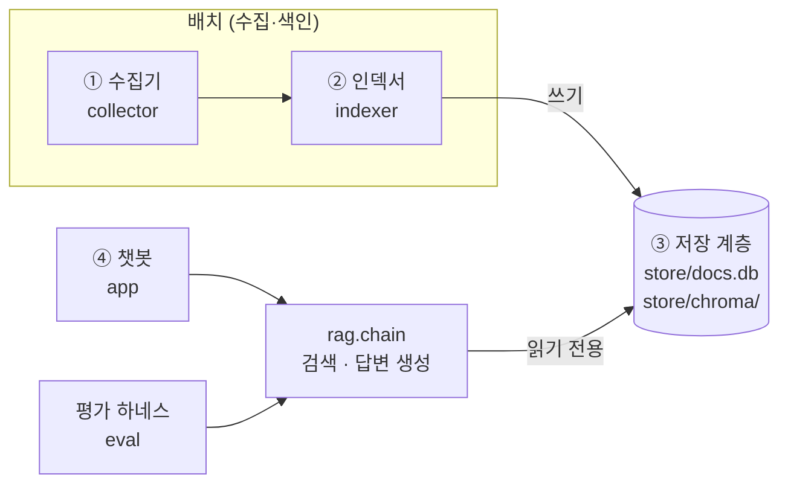

# mini_project3
AI.M 데이터분석 트랙 미니 프로젝트 3 — 공공 문서·웹검색 결합 RAG 기반 질의응답 시스템

> 이 과제의 기준은 "챗봇이 동작하는가"가 아니라
> **"이 챗봇의 답변을 신뢰할 수 있는가, 그 판단의 근거는 무엇인가"** 에 측정으로 답하는 것이다.

## 시스템 정의

| 항목 | 내용 |
|---|---|
| 주제 | A. 지역 상권·소상공인 정책 |
| 대상 사용자 | 카드사 상권·가맹점 데이터 분석가 |
| 업무 상황 | 상권·가맹점 지표에서 변화나 이상치를 발견했을 때, 배경이 되는 정책·이슈를 근거 문서로 확인하고 분석 리포트에 인용한다 |
| 지역 범위 | 정책은 전국 단위, 지자체 사업은 서울시·자치구 |
| 업종 범위 | 전 업종. 카페·외식업은 미니프로젝트 2와 이어지는 대표 시나리오로 다룬다 |

미니프로젝트 1(서울 자치구 인구 구조 × 상권 업종)과 미니프로젝트 2(생활인구 기반 2030 카페 입지 대시보드)의
수치 분석 결과에 정책·시장 맥락을 근거와 함께 결합한다. 지식베이스는 공개 문서로만 구성하며
카드 결제 데이터 등 비공개 자료는 사용하지 않는다.

### 지식베이스 구성 (계획)

| 구분 | 자료 | 문서 종류 |
|---|---|---|
| 제공 | 소상공인 묶음 뉴스 42,453건 (소상공인 지원정책·상권 활성화·전통시장 활성화·골목상권·소상공인 폐업) | `news` |
| 제공 | 지역화폐 뉴스 36,888건 — 가이드의 주제 A 키워드 '지역사랑상품권'을 대신함 | `news` |
| 직접 수집 | 중소벤처기업부·소상공인시장진흥공단 보도자료 | `press_release` |
| 직접 수집 | 금융위원회 카드수수료(영세·중소가맹점 우대) 보도자료 | `press_release` |
| 직접 수집 | 서울시·자치구 상권 지원사업 공고 | `announcement` |
| 직접 수집 (진행 중) | 국책·지자체 연구기관 보고서 10~20건 선별 (NKIS, 서울연구원 등) — 선별 기준은 아래 | `policy_report` |
| 직접 수집 (미완) | 핵심 법령 현행 조문 3~5개 (국가법령정보센터) — 인증값 미발급 | `law` |
| ~~직접 수집 (선택)~~ **제외** | 블로그 — 소상공인 체감 반응. 사유는 아래 | `blog` |

**블로그를 제외한 이유**
- 분석가의 업무는 지표 변화의 근거를 리포트에 인용하는 것이다. 인용할 수 있는 근거는 정책 원문·보도·연구이고, 개인 체감 글은
  근거로 쓰기 어렵다.
- 출처 신뢰도가 가장 낮다 (`SourceTier.USER_GENERATED`). 광고·체험단 글을 거르는 필터와 표본 검증이 따로 필요하다.
- 검색 API 의 키·이용 약관과, 개인 글의 저작권·개인정보를 확인해야 한다.
- 지금 평가셋에는 블로그로만 답할 수 있는 문항이 없어 넣어도 효과를 잴 수 없다.
- 현장 반응은 뉴스가 인용한 인터뷰·설문으로 일부 대신한다 (예: s005 소상공인 설문).

**연구기관 보고서 선별 기준** (보고서를 보기 전에 정함)
- 발행 2021-10 ~ 2026-10 (제공 뉴스 기간)
- 주제: 소상공인·자영업, 골목상권·전통시장, 지역화폐·소비 지원(소비쿠폰 등), 유통 규제(대형마트 의무휴업), 카드수수료·가맹점
- 기관: 국책연구기관(NKIS 소관 — KDI·산업연구원·조세재정연구원 등), 중소벤처기업연구원, 서울연구원
- PDF 원문 공개, robots.txt 허용, 이용 조건 확인 가능
- 주제별 2~4건, 최신 우선, 총 10~20건
- 색인 범위는 요약(정책 제언 포함)과 결론 장이다. 방법론·부록까지 넣으면 청크가 크게 늘고 검색이 흐려진다.
- 효과는 보고서로 답하는 평가 문항 2~3개를 추가해 따로 잰다 (1차 자료 문항 방식)

법령 후보 (Day 1 확정): 지역상권 상생 및 활성화에 관한 법률, 전통시장 및 상점가 육성을 위한 특별법,
여신전문금융업법(우대수수료 근거), 상가건물 임대차보호법, 지역사랑상품권 이용 활성화에 관한 법률.
국회 법안·검토보고서가 아니라 현행 조문만 넣는다. 분석가에게 필요한 것은 현재 적용 기준이기 때문이다.

제공 뉴스는 기간 2021-10-16 ~ 2026-10-16이며, 가이드의 주제 A 키워드 중 핵심 5개만 키워드로 수집되었다.
정책자금·상권활성화구역·공실·임대료·젠트리피케이션·생활인구 등은 별도 수집되지 않았으므로
EDA(`notebooks/eda.ipynb` 8번)로 본문 등장 건수를 확인하고, 부족한 영역을 직접 수집으로 보강한다.
서울 범위·품질 필터와 중복 처리는 적재 후 인덱서에서 적용한다 (처리 전후 건수 기록).

### 직접 수집 소스 접근 확인 (`python -m collector probe`, 2026-11-03, 수집 PC 에서 실행)

| 소스 | robots.txt | 결과 | 판단 |
|---|---|---|---|
| 정책브리핑 보도자료 (`korea.kr/briefing/pressReleaseList.do`) | 허용 | 목록 정적 HTML, 검색어·기간 파라미터 동작. 상세 본문은 문서뷰어 iframe 이라 HTML 에 없고, 원문 PDF·HWPX 첨부(내려받기 허용) | 주 수집원. 부처 보도자료(중기부·금융위 포함)를 검색어·기간으로 찾고 **PDF 원문에서 본문 추출**. 공공누리 제1유형(텍스트) |
| 금융위원회 보도자료 (`fsc.go.kr/no010101`) | 허용 | 목록·상세 정적 HTML, 첨부 `/comm/getFile` | 카드수수료 보도자료 원문 첨부 보강 |
| 중소벤처기업부 보도자료 (`mss.go.kr/.../List.do?cbIdx=86`) | 허용 | 상세 링크가 일반 주소가 아님(`#view`) | 같은 보도자료가 정책브리핑에 있어 별도 수집하지 않음 |
| 서울시 경제분야 누리집 (`news.seoul.go.kr/economy`) | 허용 | 목록·상세 정적 HTML (본문 `#post_content`) | 서울 소상공인 지원사업 안내. 공공누리 제4유형(출처표시·비상업·변경금지) |
| 서울시 보도자료 (`www.seoul.go.kr/news`) | **금지** | 요청하지 않음 | 제외 |
| 국가법령정보센터 Open API (`law.go.kr/DRF`) | 허용 | 응답 확인, 인증값(OC) 필요 | 활용 신청 후 법령 수집 |
| 공공데이터포털 Open API (`apis.data.go.kr`) | 규칙 없음 | 서버 응답 확인 | 필요 시 사용 (서비스키) |

이용약관(공공누리 유형)은 수집 대상 페이지에서 확인해 리포트에 기록한다.

### 대표 질문

평가셋에서 업무 상황(지표 변화의 정책 배경 확인)을 대표하는 문항을 유형별로 골랐다. 결과는 채택 설정(하이브리드 검색 +
1차 자료, 문서당 청크 2개, 프롬프트 v1)의 3회 실행 직접 채점이다. 챗봇 빈 화면의 예시 질문과 같다.

| 유형 | 질문 (평가셋 id) | 확인하는 것 | 결과 (3회) |
|---|---|---|---|
| 사실 · 1차 자료 | 2026년 상반기 우대수수료율이 적용되는 영세·중소 신용카드가맹점은 몇 개이고 전체의 몇 %인가? (f023) | 가맹점 수수료 기준 — 금융위 보도자료에만 있는 최신 수치 | 정확 3 (뉴스만: 오답 3) |
| 사실 · 카드 매출 | 한국신용데이터 분석에서 민생회복 소비쿠폰 지급 첫 주 소상공인 카드 매출은 어떻게 변했고, 가장 크게 늘어난 업종은? (f019) | 매출 지표 변화의 정책 배경 | 정확 3 |
| 시점 | 영세·중소가맹점 신용카드 우대수수료율은 2025년에 어떻게 바뀌었나? (t013) | 변경 전후 값과 적용 시점 | 정확 3 (뉴스만: 오답 3) |
| 비교 | 중기부와 서울시의 자영업자 고용보험료 지원은 환급 비율과 기간이 어떻게 다른가? (c005) | 전국 정책과 서울시 사업 비교 | 정확 3 (뉴스만: 오답 3) |
| 종합·판단 | 민생회복 소비쿠폰의 소비 진작 효과에 대해 어떤 긍정적 평가와 비판이 있나? (s005) | 상충 근거를 양쪽 모두 제시 | 정확 3 |
| 답변 불가 | 망원동 카페들의 월평균 카드 매출액은 얼마인가? (u001) | 비공개 데이터 — 거절이 정답 | 거절 3 |

비교·시점 문항 전체로는 아직 약하다 (비교 정답률 20%, 시점 38%, 리포트 6·8장). 대표 질문은 잘 되는 사례만이 아니라
업무 유형별 기준 문항이며, 약한 사례(t009 시점 혼동, c003·c004 잘못된 거절)는 리포트에 따로 적었다.

## 아키텍처



- 데이터 흐름은 단방향이다. 챗봇은 인덱스에 쓰지 않고, 임베딩은 **질문 벡터화에만** 사용한다.
- `rag/` 를 챗봇과 평가 하네스가 공유한다. 평가한 체인과 서비스하는 체인이 같아야 평가가 유효하다.
- 계층 간 공유가 필요한 요소(설정, 스키마, 임베딩 모델, 원문 DB 접근)는 `common/` 에만 둔다.
  `rag` 가 `indexer` 를 import 하면 "인덱서 없이 챗봇 구동" 요건이 깨지기 때문이다.
- 계층 분리 규칙은 `tests/test_layer_boundaries.py` 가 정적으로 검사한다.

### 원문 DB(`store/docs.db`) 테이블 소유권

| 테이블 | 기록 계층 | 내용 |
|---|---|---|
| `documents` | collector | 수집 원문, 출처·제목·URL·발행일·문서 종류·수집 일시 |
| `processed_documents` | indexer | 정제 본문, 중복 판정 결과(`kept`/`duplicate`/`excluded`) |

`rag`/`app`/`eval` 은 `open_db(read_only=True)` 로만 연다 (SQLite 수준에서 쓰기 차단).

## 디렉터리 구조

```
mini_project3/
├── common/                 # 계층 공용
│   ├── config.py           #   경로·모델·크롤링 설정 (.env 로드)
│   ├── schema.py           #   문서 종류, 출처 신뢰도, 청크 메타데이터 필드
│   ├── embeddings.py       #   임베딩 모델 생성 (indexer·rag 공용)
│   └── docstore.py         #   원문 DB 접근
├── collector/              # ① 수집 계층 (배치)
│   ├── __main__.py
│   ├── fetch.py            #   robots.txt·딜레이를 강제하는 공용 요청 모듈
│   ├── probe.py            #   수집 후보 사이트 접근 확인 (robots.txt·응답·표본 HTML)
│   ├── load_provided.py    #   제공 데이터 적재 및 선별
│   ├── crawl_korea_kr.py   #   정책브리핑 보도자료 수집 (PDF 원문)
│   ├── crawl_seoul_economy.py # 서울시 경제분야 누리집 소상공인 지원 소식
│   ├── crawl_blog.py       #   블로그 검색 API 수집
│   ├── collect_law.py      #   법령 현행 조문 수집
│   └── storage.py          #   원본 파일 저장, doc_id 생성
├── indexer/                # ② 인덱싱 계층 (배치)
│   ├── __main__.py
│   ├── prepare.py          #   정제 → 품질 필터 → 중복 처리 (processed_documents) + 키워드 색인
│   ├── parse.py            #   PDF·HTML 텍스트 추출, 보일러플레이트 제거
│   ├── quality.py          #   품질 필터 (범위 밖·불량 제외, 신뢰도 플래그)
│   ├── dedup.py            #   완전 중복·재배포본 처리 (본문 유사도)
│   ├── chunk.py            #   문서 종류별 청킹 설정
│   └── embed.py            #   임베딩·Chroma 적재·검증
├── store/                  # ③ 저장 계층 (git 미포함, 인덱서 실행으로 생성)
│   ├── docs.db
│   └── chroma/
├── rag/                    # 체인 (챗봇과 평가가 공유)
│   ├── retriever.py
│   ├── chain.py
│   └── prompts.py
├── eval/                   # 평가 하네스
│   ├── README.md           #   평가셋 작성 가이드
│   ├── eval_set.jsonl
│   ├── find_docs.py        #   정답 문서 검색
│   ├── pool.py             #   정답 문서 보정 (검색 결과 판정 → 평가셋 반영)
│   ├── grade.py            #   답변 직접 채점 집계 · 이전 채점 옮기기
│   ├── run_eval.py
│   └── results/            #   실험별 결과 (git 포함)
├── app/                    # ④ 챗봇 UI (조회 전용)
│   ├── main.py             #   진입점: 페이지 구성, 상단 내비게이션
│   ├── chat.py             #   대화 화면 (검색 상태·스트리밍·출처 카드·원문 확인)
│   ├── sources.py          #   화면용 순수 로직 (출처 변환, 답변 마크다운 정리, 필터, 하이라이트 위치)
│   ├── components.py       #   화면 조각 HTML (값은 모두 escape)
│   ├── theme.py            #   디자인 토큰·전역 CSS
│   ├── dashboard.py        #   평가 결과 시각화 (요약·검색·답변·거절 임계값·지식베이스)
│   ├── experiments.py      #   대시보드에 싣는 실험 목록 (eval/results 폴더 이름)
│   ├── eval_data.py        #   결과 파일 → 표 (eval 패키지는 import 하지 않음)
│   └── charts.py           #   Plotly 차트
├── .streamlit/config.toml  # Streamlit 테마 (디자인 토큰)
├── data/                   # 제공 데이터·크롤링 원본 (git 미포함)
│   ├── provided/
│   └── raw/
├── notebooks/eda.ipynb     # 문서 탐색
├── report/report.md        # 리포트
└── tests/
```

## 설치

Python 3.11 이상이 필요하다.

```bash
python -m venv .venv
```

```bash
source .venv/bin/activate   # Windows: .venv\Scripts\activate
```

```bash
pip install -r requirements-dev.txt
```

```bash
cp .env.example .env        # 이후 .env 에 OPENAI_API_KEY 등을 채운다
```

## 실행 순서

모든 명령은 프로젝트 루트에서 실행한다. 각 계층은 독립적으로 실행된다.

**① 수집** — 결과: `store/docs.db` 의 `documents`, `data/raw/`

제공 CSV(소상공인 묶음, 지역화폐)를 **원래 파일명 그대로** `data/provided/` 에 넣은 뒤 적재한다.
파일명의 추출 기간을 수집 일시로 쓰기 때문이다.

```bash
python -m collector provided
```

직접 수집 크롤러를 만들기 전에, 수집할 PC 에서 후보 사이트의 robots.txt 와 응답을 확인한다.
결과는 `data/raw/_probe/report.txt`, 받은 HTML 은 같은 폴더에 저장된다 (파서 작성용 표본).

```bash
python -m collector probe
```

정책브리핑 보도자료는 검색어·기간(기본: 제공 뉴스와 같은 2021-10-16 ~ 2026-10-16)으로 찾고 부처명과
제목 키워드로 거른다. 검색이 본문·첨부까지 찾아 지나가듯 언급한 보도자료도 나오기 때문이다
('카드수수료' 148건 중 다수가 가상자산·중동 상황 점검 등). `--dry-run` 은 받을 목록만 보여 준다.
PDF 원문(없으면 HWPX)을 `data/raw/press_release/` 에 저장하고, 본문 추출은 인덱서(`indexer prepare`)가 한다.
옛 HWP 만 첨부된 보도자료는 받지 않고 '원문 없음'으로 보고한다.
이미 받은 문서는 건너뛰므로 중단되면 같은 명령을 다시 실행한다. 먼저 `--count-only` 로 결과 수를 확인한다.

```bash
python -m collector korea-kr --query 소상공인 --ministry 중소벤처기업부 --count-only
```

```bash
python -m collector korea-kr --query 소상공인 --ministry 중소벤처기업부
```

서울시 경제분야 누리집의 소기업·소상공인 종합지원 새소식은 본문을 수집 시점에 추출해 저장한다
(본문 영역 태그가 닫히지 않아 태그 목록 앞에서 잘라야 하는 등 사이트 구조에 맞춘 처리라 수집기가 맡는다).

```bash
python -m collector seoul-economy
```

```bash
python -m collector blog --query "검색어"
```

```bash
python -m collector law --name "법령명"
```

**② 인덱싱** — 결과: `processed_documents`, `store/chroma/` 의 `docs__<설정명>` 컬렉션

```bash
python -m indexer prepare
```

품질 필터 없이 실행하면 개선 전 기준 실험이 된다 (`--quality none`). 결과 요약의 사유별 건수가 처리 전후 건수다.

```bash
python -m indexer prepare --quality none
```

먼저 `--dry-run` 으로 청크 수·길이 분포를 확인한 뒤 임베딩한다. 중간에 API 오류로 멈추면 같은 명령을 다시 실행하면 이어서 적재한다.

```bash
python -m indexer build --chunk-config c500 --dry-run
```

```bash
python -m indexer build --chunk-config c500
```

```bash
python -m indexer build --chunk-config c1000
```

```bash
python -m indexer verify --collection docs__c500
```

**평가** — 결과: `eval/results/<일시>_<태그>/`

청킹 설정별로 같은 평가셋을 돌려 Hit@1·Hit@3·Hit@5·MRR 을 비교한다. 검색은 챗봇과 같은 `rag.retriever` 로 한다.

```bash
python -m eval.run_eval --tag baseline-c1000 --collection docs__c1000
```

```bash
python -m eval.run_eval --tag baseline-c500 --collection docs__c500
```

하이브리드 검색(의미 검색 + 키워드 BM25, RRF 결합)은 `--mode hybrid` 로 비교한다. 키워드 색인은 `indexer prepare` 가 만든다.

```bash
python -m eval.run_eval --tag hybrid-c500 --collection docs__c500 --mode hybrid
```

정답 목록만 고쳤을 때는 검색을 다시 하지 않고 저장된 결과를 다시 채점한다 (원문 DB·벡터 DB·API 불필요).

```bash
python -m eval.run_eval --rescore eval/results/<실험> --tag <새 태그>
```

답변까지 생성해 거절 정확도를 집계하고, 직접 채점용 `answers.csv` 를 만든다 (챗봇과 같은 `rag.chain` 사용).

```bash
python -m eval.run_eval --tag hybrid-c500-answers --with-answers
```

`answers.csv` 의 grade(정확/부분/오답)·citation_ok(Y/N/-)·note 를 직접 채점한 뒤 집계한다. 다음 실험에서는 답변이 바뀌지 않은 문항의 채점을 옮겨 온다.

```bash
python -m eval.grade summary eval/results/<실험>/answers.csv
```

```bash
python -m eval.grade carry eval/results/<이전 실험>/answers.csv eval/results/<새 실험>/answers.csv
```

답변 근거로 넣는 문서당 청크 수는 `--context-chunks` 로 바꿔 비교한다 (기본 `RAG_CONTEXT_CHUNKS=1`). 검색 순위는 그대로이고 같은 기사의 세부 청크만 더 넣는다.

```bash
python -m eval.run_eval --tag hybrid-c500-ctx2-answers --with-answers --context-chunks 2
```

시스템 프롬프트는 `rag/prompts.py` 에 버전(`v1`, `v2` …)으로 둔다. 기존 버전 문구는 바꾸지 않고 새 버전을 추가해
`--prompt-version` 으로 비교한다 (기본값 `DEFAULT_PROMPT_VERSION`). `--seed` 는 OpenAI 재현성 옵션으로, 반복 실행 변동을
줄이는지 확인하는 데 쓴다. 두 값은 결과의 `summary.json` → `config.chain` 에 기록된다.

```bash
python -m eval.run_eval --tag hybrid-c500-ctx2-kb2-p2-r1 --with-answers --context-chunks 2 --prompt-version v2
```

`--decompose` 는 비교 질문을 LLM 으로 대상별 검색 질의로 나눠 따로 검색하고, 결과를 번갈아 합친다 (`rag/decompose.py`).
비교가 아닌 질문은 그대로 검색한다. 검색 평가에도 적용된다. 비교 문항의 대상별 근거 포함률(`cover@k`, `all@k`)은
평가셋 v2.1 의 `gold_groups` 로 잰다.

```bash
python -m eval.run_eval --tag hybrid-c500-ctx2-kb2-dec2-r1 --with-answers --context-chunks 2 --decompose
```

**④ 챗봇** — 인덱싱을 다시 실행하지 않고 단독으로 구동된다. 프로젝트 루트에서 실행해야 `.streamlit/config.toml` 테마가 적용된다.
Windows PowerShell 에서 `streamlit` 명령을 찾지 못하면(Scripts 폴더가 PATH 에 없음) `python -m streamlit` 으로 실행한다

```bash
python -m streamlit run app/main.py
```

| 화면 요소 | 내용 |
|---|---|
| 검색 상태 | 검색 중 → `근거 n건 확인 · 1차 자료 n · 언론 보도 n · 소요 시간`. 펼치면 검색 질의(후속 질문은 직전 질문을 덧붙임)·범위·기준 |
| 답변 | 스트리밍 출력. `[n]` 은 번호 배지로 바꿔 출처 카드와 연결 |
| 출처 카드 | 제목, 발행처·발행일·문서 종류, 출처 신뢰도 배지(1차 자료/언론 보도), 근거 문단 미리보기, 원문 링크. 인용된 출처만 펼치고 나머지는 접어 둔다 |
| 원문 확인 | 원문 DB 의 정제 본문 전체에서 답변 근거 문단을 하이라이트 |
| 검색 범위 | 출처 종류(뉴스·보도자료·서울시 공고), 발행일 범위. 기간을 지정하면 발행일 미상 문서는 빠진다 |
| 유사도 점수 표시 | 디버깅용: 코사인 유사도, 하이브리드 검색의 의미·키워드 순위 |
| 근거 없음 | 오류 대신 원인과 다음 행동 안내 (구체적 표현, 범위 넓히기). 검색은 됐지만 LLM 이 거절하면 검색된 문서를 접어서 보여 준다 |

**평가 결과** 페이지 (`app/dashboard.py`): 저장소의 `eval/results` 를 읽는다. 싣는 실험은 `app/experiments.py` 에서 고른다
(같은 평가셋 버전끼리만 비교하도록 짝을 지정. 새 실험을 올리려면 여기에 추가)

| 보기 | 내용 |
|---|---|
| 요약 | 채택 설정의 답변 정답률(32문항 3회 평균)과 검색·출처·거절·응답 시간 지표, 실험별 결정 기록 |
| 검색 실험 | 비교(청킹·검색 방식·1차 자료)마다 기준 대비 Hit@k·MRR, 유형별 Hit@3, 문항별 검색 시간 |
| 답변 품질 | 문항 묶음(뉴스·1차 자료·전체)·설정별 정답률과 실행별 변동, 유형별 등급(취약 유형), 문항 × 실행 등급표 (실행 간 변동과 설정 간 차이를 나눠 봄) |
| 거절 임계값 | 문항별 검색 1위 유사도 분포와 임계값(`RAG_MIN_SCORE`) — 유사도만으로 답변 불가를 가를 수 없는 근거 |
| 지식베이스 | 문서 종류별 수집 → 중복·품질 제외 → 인덱싱 건수, 발행 월 분포 (원문 DB 가 있는 PC 에서만) |

차트 색은 디자인 시스템 안에서만 쓴다: 비교는 개선안 Action Blue · 기준 회색(값을 막대 끝에 표기), 채점 등급은 정확/부분/오답 = 초록/주황/빨강,
나머지는 위치로 구분하고 한 색. 차트마다 '표로 보기'로 같은 값을 표로 볼 수 있다.

화면 디자인은 Apple 스타일 디자인 시스템(단일 Action Blue `#0066cc`, Parchment 배경 위 흰 카드와 1px 헤어라인, 그림자 없음, 17px 본문)을 따른다. 시맨틱 색은 배지·안내에만 쓴다. 토큰은 `.streamlit/config.toml` 과 `app/theme.py` 에 있다. 웹폰트(Pretendard)는 jsDelivr 에서 받으며, 못 받으면 기본 글꼴로 보인다.

**테스트**

```bash
pytest
```

## 평가셋 형식

작성 절차와 문항 재료는 [`eval/README.md`](eval/README.md) 참조. 정답 문서는 `python -m eval.find_docs <검색어>` 로 찾고 `python -m eval.run_eval --check` 로 검사한다. 실험 결과에서 정답 목록 밖 문서를 판정해 보정하는 절차는 같은 문서의 '정답 문서 보정' 참조.

`eval/eval_set.jsonl` — 한 줄에 한 문항. `id` 는 실험 간 같은 문항을 대조하는 키이므로 바꾸지 않는다.

```jsonl
{"id": "f001", "q": "...", "type": "fact", "gold_doc_ids": ["kr_20260115_1a2b3c4d"], "answer_key": "..."}
{"id": "u001", "q": "...", "type": "unanswerable", "gold_doc_ids": [], "answer_key": "지식베이스에 근거 없음. 답변 거절이 정답"}
```

| type | 검증 대상 |
|---|---|
| `fact` | 기본 검색 정확도 |
| `comparison` | 복수 문서 종합 |
| `temporal` | 발행일 정보 활용 |
| `synthesis` | 상충 근거 처리 |
| `unanswerable` | 답변 거절 (검색 지표에서는 제외, 거절 정확도로 측정) |

## 실험 기록

검색 평가 (답변 가능 24문항, k=5). 결과 파일은 `eval/results/`.

| 실험 | 평가셋 | Hit@1 | Hit@3 | Hit@5 | MRR | 평균 응답 |
|---|---|---|---|---|---|---|
| c1000 의미 검색 | v1 | 0.083 | 0.333 | 0.458 | 0.222 | 180ms |
| c500 의미 검색 (기준선) | v1 | 0.208 | 0.458 | 0.583 | 0.356 | 257ms |
| c500 하이브리드 | v1 | 0.542 | 0.667 | 0.708 | 0.599 | 350ms |
| c500 의미 검색 (기준선) | v1.2 | 0.458 | 0.667 | 0.750 | 0.576 | 235ms |
| c500 하이브리드 | v1.2 | 0.792 | 0.917 | 0.917 | 0.854 | 376ms |
| c500 하이브리드 (뉴스만) | v1.3 | 0.792 | 0.917 | 0.917 | 0.854 | 376ms |
| **c500 하이브리드 + 1차 자료 (채택)** | v1.3 | **0.833** | **0.917** | **0.917** | **0.875** | 420ms |

1. **청킹 설정**: c500 이 모든 지표에서 앞서 채택 (v1, 같은 조건 비교)
2. **실패 분석** (c500 기준선, Hit@3 실패 13문항): 질문의 연도·기관명 무시 5, 비교 문항에서 한쪽만 검색 2,
   관련 기사를 찾았지만 정답 목록에 없음 5, 기타 2
3. **평가셋 보정 v1 → v1.1** (`eval/pool.py`): 기준선·하이브리드 상위 3건 중 정답 목록 밖 83건을 판정해
   27건(13문항)을 정답에 추가, 56건은 정답 아님으로 기록 (`eval/pool_judged.json`). 두 실험 결과를 함께 판정해 공정하게 비교.
   **v1.1 → v1.2**: 답변 평가에서 발견한 판정 오류 2건(f020) 수정. 검색은 다시 하지 않고 저장된 결과를
   다시 채점했다 (`run_eval --rescore`)
4. **개선: 하이브리드 검색** — 키워드 색인(한글 2-gram·숫자)과 의미 검색을 RRF 로 결합. v1.2 기준 Hit@3 +0.250,
   MRR +0.278. 응답 시간은 평균 +140ms. 유형별 Hit@3: fact 0.6 → 1.0, temporal 0.667 → 0.833,
   comparison 0.5 → 0.75, synthesis 1.0 → 1.0
5. **1차 자료 추가** (정책브리핑 보도자료 487건·서울시 공고 32건, 청크 50,594 → 55,332): 보정 전(v1.2)에는
   Hit@3 0.917 → 0.875 로 떨어진 것처럼 보였다. 새로 검색된 보도자료가 정답 목록에 없었기 때문이다. 상위 3건을
   판정해 4건을 정답에 추가한 v1.3 에서 같은 기준으로 비교하면 Hit@1 0.792 → 0.833 (t010 정답이 2위 → 1위,
   점포철거비 600만원 상향 보도자료), Hit@3·Hit@5 는 같다. 응답 시간 +44ms.
   1차 자료가 상위 5건에 드는 문항은 30문항 중 5개(1위 2개)뿐이다. 평가셋을 뉴스로 만들었기 때문으로,
   1차 자료로 답하는 문항을 추가해 측정할 필요가 있다 (`TODO.md`)
6. **한계**: synthesis 는 한쪽 근거만 있어도 정답으로 판정해 검색 지표가 포화(1.0)되므로 답변 채점으로 평가한다.
   판정 깊이가 3이라 Hit@5·MRR 은 보수적이다. 답변 가능 문항 24개라 1문항이 약 0.04 에 해당한다

답변 평가 (하이브리드 c500, gpt-4o-mini, RAG_MIN_SCORE 0.5, 직접 채점). 개선 실험: 답변 근거의 문서당 청크 수 1 → 2

| 유형 | 청크 1개 정확/부분/오답 | 청크 2개 정확/부분/오답 | 정답률 1 → 2 |
|---|---|---|---|
| fact (10) | 7 / 2 / 1 | 9 / 1 / 0 | 70% → 90% |
| temporal (6) | 3 / 2 / 1 | 3 / 1 / 2 | 50% → 50% |
| comparison (4) | 0 / 1 / 3 | 0 / 1 / 3 | 0% → 0% |
| synthesis (4) | 2 / 2 / 0 | 2 / 2 / 0 | 50% → 50% |
| **답변 가능 계 (24)** | **12 / 7 / 5** | **14 / 5 / 5** | **50% → 58%** (부분 포함 79% → 79%) |
| 답변 불가 (6) | 거절 6 | 거절 6 | 거절 정확도 100% |
| 출처 정확도 | 86% (18/21) | **95%** (20/21) | |
| 평균 응답 시간 | 2.4초 | 2.8초 | |

결과: `eval/results/20261103-1649_hybrid-c500-answers/`(청크 1개), `eval/results/20261103-1711_hybrid-c500-ctx2-answers/`(청크 2개)

**1차 자료 추가 후 답변** (청크 2개, 평가셋 v1.3, `eval/results/20261104-1040_hybrid-c500-ctx2-kb2-answers/`)

| | 정확 / 부분 / 오답 | 정답률 (부분 포함) | 출처 정확도 | 거절 정확도 |
|---|---|---|---|---|
| 뉴스만 | 14 / 5 / 5 | 58% (79%) | 95% (20/21) | 100% |
| + 1차 자료 | 12 / 6 / 6 | 50% (75%) | 90% (19/21) | 100% |

- 등급이 바뀐 3문항 중 **1차 자료 때문인 것은 t007 하나**다 (정확 → 부분). 시행 전 보도자료(2025-02-10)가
  근거 1위가 되면서 '지급 시작(2.21)' 대신 '신청 시작(2.17)'을 답했다
- **t012(정확 → 부분)·c002(부분 → 오답)는 검색 결과와 순서가 이전과 같은데 답변이 달라졌다.** temperature 0 에서도
  생성 결과가 실행마다 달라진다

**같은 설정 반복 실행 (변동 폭)** — 1차 자료 포함 설정을 3회 실행해 각각 직접 채점 (`...-kb2-answers`, `-r2`, `-r3`)

| 실행 | 정확 / 부분 / 오답 | 정답률 (부분 포함) | 출처 정확도 |
|---|---|---|---|
| 1회 | 12 / 6 / 6 | 50.0% (75.0%) | 90.5% |
| 2회 | 11 / 4 / 9 | 45.8% (62.5%) | 81.0% |
| 3회 | 11 / 7 / 6 | 45.8% (75.0%) | 90.5% |
| 평균 | 11.3 / 5.7 / 7.0 | 47.2% (70.8%) | 87.3% |
| (참고) 뉴스만, 1회 | 14 / 5 / 5 | 58.3% (79.2%) | 95.2% |

- 검색 결과는 세 번 모두 같고(Hit@3 0.917), 거절 판단도 같다 (거절 정확도 100%, 잘못된 거절 t011·c003·c004).
  **답변 가능 24문항 중 5문항의 등급이 실행마다 달라진다**:

  | 문항 | 뉴스만 | 1회 · 2회 · 3회 | 흔들린 이유 |
  |---|---|---|---|
  | t007 | 정확 | 부분 · 오답 · 부분 | 지급 시작 대신 신청 시작(2.17)·확인지급(4.21)을 답함 — **세 번 모두 뉴스만보다 낮음: 1차 자료 효과** |
  | c002 | 부분 | 오답 · 오답 · 부분 | '2차 소비쿠폰 대상 1500만명 감소'라는 틀린 결합 문장이 생겼다 없어졌다 함 |
  | s001 | 정확 | 정확 · 오답 · 정확 | 2회에서 더불어민주당을 '여당'으로 표기 |
  | s006 | 부분 | 부분 · 오답 · 부분 | 2회에서 행안부 논리를 거꾸로 기술 |
  | f013 | 정확 | 정확 · 정확 · 오답 | 3회에서 할인율을 '최대 12%'로 잘못 합산 |

- 정답률은 실행마다 1문항(4%p), 부분 포함 정답률은 3문항(12.5%p)까지 흔들린다. 흔들린 것은 모두 여러 시점·주체·수치를
  묶어 서술하는 문항(temporal·comparison·synthesis, f013)이고, 한 가지 사실을 묻는 fact 문항은 안정적이다
- 답변 비교는 단일 실행이 아니라 반복 실행 평균과 문항별 일관성으로 판단한다

**뉴스만 vs 1차 자료 포함 (각 3회, 같은 컬렉션)** — 뉴스만은 `run_eval --doc-types news` 로 같은 컬렉션에서 1차 자료를
빼고 검색했다 (`...-ctx2-news-r1~r3`). 검색 지표는 원래 뉴스만 지식베이스와 같다 (Hit@3 0.917, MRR 0.854)

| 설정 | 정확 (3회) | 정답률 평균 | 부분 포함 평균 | 점수 평균 (정확 1·부분 0.5) | 출처 정확도 평균 |
|---|---|---|---|---|---|
| 뉴스만 | 13 · 12 · 14 | 54.2% | 70.8% | 62.5% | 85.7% |
| + 1차 자료 | 12 · 11 · 11 | 47.2% | 70.8% | 59.0% | 87.3% |

| 문항 | 뉴스만 (1·2·3) | + 1차 자료 (1·2·3) | 점수 차 |
|---|---|---|---|
| t007 | 정확 · 정확 · 정확 | 부분 · 오답 · 부분 | −0.67 |
| t012 | 정확 · 부분 · 정확 | 부분 · 부분 · 부분 | −0.33 |
| s001 | 정확 · 정확 · 정확 | 정확 · 오답 · 정확 | −0.33 |
| f013 | 오답 · 오답 · 정확 | 정확 · 정확 · 오답 | +0.33 |
| c002 | 오답 · 오답 · 오답 | 오답 · 오답 · 부분 | +0.17 |
| s006 | 부분 · 부분 · 오답 | 부분 · 오답 · 부분 | 0 |

- 나머지 18문항은 여섯 번 모두 같은 등급이다. 점수 차 합계는 −0.83점(24문항 중)이고 그중 −0.67점이 t007 이다
- **결론**: 뉴스로 만든 문항에서 1차 자료 추가의 영향은 t007 하나(일관된 하락)를 빼면 실행 간 변동과 구분되지 않는다.
  부분 포함 정답률은 같고 출처 정확도는 비슷하다. 처음 비교(뉴스만 1회 58%)의 차이는 상당 부분 변동이었다.
  c002 의 틀린 결합 문장, f013 의 '최대 12%' 오계산, s006 의 논리 반전은 뉴스만 설정에서도 나온다
- 1차 자료의 효과는 1차 자료로 답하는 문항에서 따로 잰다 (아래)

**1차 자료 문항 (평가셋 v2.0 추가 8문항)** — 보도자료·서울시 공고 전문으로 만든 문항 (eval/README.md).
같은 내용을 옮긴 뉴스는 두 설정의 검색 결과로 판정해 정답에 넣었다 (8문항 중 4문항에 뉴스 정답 있음).
`run_eval --ids` 로 8문항만 설정별 3회 실행 (`primary8-*`)

| 설정 | 검색 Hit@3 · MRR | 정확 / 부분 / 오답 (3회 모두 같음) | 정답률 | 출처 정확도 |
|---|---|---|---|---|
| + 1차 자료 | 0.875 · 0.812 | 7 / 0 / 1 | **87.5%** | 100% (7/7) |
| 뉴스만 | 0.375 · 0.406 | 1 / 2 / 5 | 12.5% (부분 포함 37.5%) | 60% (3/5) |

- 뉴스만 설정은 f023(2026 상반기 가맹점 수)·t014(비즈플러스카드 기준 변경)를 근거가 없어 거절하고, t013 은 2025년
  인하 전후 대신 2020년 수수료율과 비교했으며, c005 는 2023년 지원율을 섞어 '서울시 최대 100%'로 잘못 비교했다.
  f026 은 2025년 기사를 2026년 사업으로 인용했다. 뉴스로는 최신 제도의 세부 기준을 정확히 답하기 어렵다
- 두 설정 모두 f021(부담경감 크레딧)은 1위 유사도 0.484 로 임계값(0.5) 미만이라 거절했다. 1차 자료 포함 설정은
  근거 보도자료가 상위 5건에도 없었다 (1위는 4월 추경 기사). 긴 보도자료에서 여러 사업 중 하나로 다뤄진 경우의
  검색 실패로, 개선 후보로 남긴다 (`TODO.md`)
- 8문항은 실행 간 등급 변동이 없었다. 한 가지 사실·기준을 묻는 문항이 대부분이기 때문으로, 앞의 변동 분석과 일치한다
- **종합** (답변 가능 32문항 기준 추정, 3회 평균): 1차 자료 포함 (11.3 + 7) / 32 = **57.3%**, 뉴스만 (13 + 1) / 32 = 43.8%.
  뉴스 문항에서는 차이가 변동 범위 안(t007 제외)이고, 1차 자료 문항에서는 75%p 차이가 난다. 1차 자료를 유지한다
- 잘못된 거절(t011·c003·c004)과 시점 혼동(t009·s006)은 그대로다. 1차 자료로 답이 바뀐 문항이 적은 것은
  평가셋을 뉴스로 만들었기 때문이다 (검색에서도 1차 자료가 상위 5건에 든 문항은 5개)

**프롬프트 v2: 날짜 종류 구분 규칙 (t007 대응)** — 1차 자료 포함 설정에서 t007 이 3회 모두 나빠진 원인은 질문('언제부터
지급')과 다른 종류의 날짜를 답한 것이었다 (시행 전 보도자료의 신청 시작일 2.17, 2회는 확인지급 신청일 4.21). v1 규칙 8개에
규칙 9 '신청·접수 시작일, 지급 시작일, 시행·발표일을 구분해 질문이 묻는 날짜로 답하고, 없으면 확인되지 않는다고 밝힌 뒤 다른
날짜를 종류와 함께 적는다. 단계가 나뉜 사업은 단계별로 나눠 적는다'를 더했다 (`rag/prompts.py`, 문항 전용 표현은 넣지 않음).
평가셋 v2.0 전체 38문항을 3회 실행해 v1 3회와 비교 (`...-kb2-p2-r1~r3`, `run_eval --prompt-version v2`)

| 설정 | 정답률 (1·2·3회) | 평균 | 부분 포함 | 출처 정확도 | 잘못된 거절 |
|---|---|---|---|---|---|
| v1 (기존) | 59.4 · 56.2 · 56.2% | 57.3% | 75.0% | 90.5% | 12.5% (t011·c003·c004·f021) |
| v2 | 56.2 · 59.4 · 56.2% | 57.3% | 77.1% | 96.3% | 15.6% (+ f006) |

| 문항 | v1 (1·2·3) | v2 (1·2·3) | 점수 차 | 내용 |
|---|---|---|---|---|
| t012 | 부분 · 부분 · 부분 | 정확 · 정확 · 정확 | +0.50 | 4월 기준(30억원 초과 주유소 불가)과 5월 허용을 시점별로 구분 — v1 의 시점 혼동이 사라짐 |
| t007 | 부분 · 오답 · 부분 | 부분 · 부분 · 부분 | +0.17 | 4.21 오답은 사라졌지만 2.21 은 못 맞힘: 지급일이 2.20 기사 본문에 '내일부터'로만 있어 발행일 2.20 을 지급일로 씀(2회), 또는 공고일·신청일만 종류를 밝혀 답함(1회) |
| **f006** | 정확 · 정확 · 정확 | 오답 · 오답 · 오답 | **−1.00** | 검색 결과가 같은데 잘못된 거절 (seed 실행까지 6회 모두). v1 답변에도 '…은 확인되지 않는다' 문장이 붙던 문항으로, '확인되지 않으면 밝힌다' 문구가 거절 쪽으로 기울게 함 |
| t013 | 정확 · 정확 · 정확 | 부분 · 정확 · 정확 | −0.17 | '단계별로 나눠 적는다'에 따라 상·하반기를 나눠 적다가 '2025년 동일 유지'로 결론 (seed 포함 6회 중 2회) |
| f013 · c002 · s006 · s001 | | | +0.83 | 원래 실행마다 흔들리던 문항 (앞의 변동 분석) — 규칙 효과로 보지 않음 |

- 점수 차 합계 +0.33점(32문항 중)으로 정답률은 같다. 출처 정확도 상승은 v1 에서 인용이 틀렸던 오답(c002 2회, t007·s006·f013
  각 1회)이 v2 에서 나오지 않은 영향이다 (t009 의 인용 오류는 두 설정 모두 3회)
- **결론: v2 는 채택하지 않는다** (기본 `DEFAULT_PROMPT_VERSION = "v1"` 유지). t012 처럼 날짜·시점 구분이 도움이 되는 문항이 있지만
  f006 의 일관된 잘못된 거절이 이득을 상쇄하고, 목표였던 t007 도 정답이 되지 않았다
- t007 의 남은 원인은 날짜 종류가 아니라 **상대 날짜**다 (기사 본문 '내일부터' + 발행일 2.20 = 지급 2.21). 다음 후보 v3 는 v1 에
  '문서 본문의 상대적 시점 표현은 그 문서의 발행일 기준으로 실제 날짜로 바꾼다'와 날짜 종류 구분만 더하고, 부작용을 부른 두 문구
  ('확인되지 않으면 밝힌다', '단계별로 나눠 적는다')는 뺐다. 같은 평가셋으로 규칙을 고치는 것이라 평가셋에 맞추는 위험이 있어,
  문항 전용 표현은 넣지 않고 전체 문항에서 부작용이 없는지로 판단한다

**프롬프트 v3: 상대 날짜 규칙** — v2 분석으로 고친 규칙. v1 에 '문서 본문의 오늘·내일·내년 같은 상대 표현은 그 문서의 발행일 기준으로
실제 날짜로 바꿔 적고, 발행일을 본문 사건의 날짜로 쓰지 않는다'와 '신청·접수 시작일과 지급 시작일은 다르므로 질문이 묻는 날짜로
답한다'만 더했다 (v2 에서 부작용을 부른 '확인되지 않으면 밝힌다'·'단계별로 나눠 적는다'는 뺌). 38문항 3회 (`...-kb2-p3-r1~r3`).
실행 전에 정한 채택 기준: ① t007 3회 모두 정확 ② f006·t013 이 v1 수준 ③ 전체 정답률 v1 이상

| 설정 | 정답률 (1·2·3회) | 평균 | 부분 포함 | 출처 정확도 | 잘못된 거절 |
|---|---|---|---|---|---|
| v1 (기존) | 59.4 · 56.2 · 56.2% | 57.3% | 75.0% | 90.5% | 12.5% |
| v3 | 59.4 · 62.5 · 59.4% | 60.4% | 81.2% | 92.9% | 12.5% |

| 문항 | v1 (1·2·3) | v3 (1·2·3) | 점수 차 |
|---|---|---|---|
| t007 | 부분 · 오답 · 부분 | 부분 · 부분 · 부분 | +0.17 |
| t012 | 부분 · 부분 · 부분 | 부분 · 정확 · 부분 | +0.17 |
| f013 · c002 · s001 · s006 | (각 1~2회 오답) | 오답 없음 | +1.17 |
| f006 · t013 · 1차 자료 문항 8개 | | v1 과 같음 | 0 |

- 나빠진 문항은 없고 점수 차 합계는 +1.5점(32문항 중). 오른 문항은 모두 원래 실행마다 흔들리던 문항이다. 다만 f013(최대 12% 오계산)·
  c002(틀린 결합 문장)·s006(행안부 논리 반전)의 틀린 서술은 v2·v3 9회 실행에서 한 번도 나오지 않았다 (v1 3회 중 4번) — 규칙 내용과
  무관하게 프롬프트가 바뀌어 생성이 달라진 영향일 수 있다
- **t007 은 3회 모두 부분**이다. 모델이 지급일을 아예 쓰지 않고 공고일(2.10)·신청 시작일(2.17)만 답했다. 지급일이 있는 근거(2.20
  기사의 '내일부터')를 날짜 근거로 쓰지 않아 상대 날짜 규칙이 작동할 기회가 없었다. t012 는 2회 행안부 논리를 거꾸로 적어 부분
- **결론: 기준 ①을 못 맞춰 기본값은 v1 을 유지한다.** v3 는 회귀 없는 후보로 남긴다 (정답률 +3.1%p 는 1문항이고, 실행 간 변동이
  1문항이라 변동 범위의 경계다). 채택하려면 평가셋에 없는 문항으로 다시 확인해야 한다
- **t007 은 프롬프트로 해결되지 않는 한계로 기록한다**: 1차 자료(보도자료)에는 신청일만 있고 지급 시작일은 기사 본문에 상대 표현으로만
  있다. 색인 단계에서 상대 날짜를 발행일 기준 날짜로 바꿔 두는 방법(`TODO.md` 품질 개선 후보, t011 과 같은 원인)으로 다룬다

**비교 질문 분해 v1** — 비교 질문은 한쪽 대상의 문서가 상위를 채운다. 평가셋 v2.1 에 비교 문항의 대상별 정답 문서
(`gold_groups`)를 적고 대상별 근거 포함률을 재면, 채택 설정에서 양쪽 근거를 모두 찾은 문항은 5개 중 2개(c002·c005)다
(all@5 0.40, cover@5 0.60). v1 은 LLM 이 질문을 대상별 질의로 나누고, 질의별 검색 결과를 순위대로 번갈아 합쳤다
(`--decompose`, `...-kb2-dec-r1~r3`).

| 설정 | Hit@1 | Hit@3 | MRR | cover@5 | all@5 | 평균 검색 시간 |
|---|---|---|---|---|---|---|
| 분해 없음 | 0.844 | 0.938 | 0.891 | 0.60 | 0.40 | 346ms |
| 분해 v1 (3회) | 0.594 · 0.625 · 0.594 | 0.781 | 0.69 ~ 0.71 | 0.50 | 0.40 | 1.7 ~ 2.4초 |

- LLM 이 38문항 중 25개를 쪼갰다. 대부분 비교가 아니라 한 대상의 여러 항목('지급 금액과 지급 인원', '지원 대상과 지원
  내용')을 나눈 것이다. 번갈아 합치면서 질문 전체와 맞던 문서가 밀려 t004·f007·f013·s004 의 정답이 상위 3건 밖으로 나갔다
- 비교 문항은 c004 만 양쪽을 찾게 됐고, c002 는 오히려 양쪽 정답을 모두 놓쳤다. 새로 검색된 문서 66건은 정답 판정을 하지
  않은 문서다 (예: c001 '1차 소비쿠폰 누가·어디서·어떻게 받나'). 포함률이 실제보다 낮게 잡혔을 수 있지만, 사실 문항의 정답
  순위가 밀린 것은 판정과 무관한 손실이다
- **결론: 채택 기준 ①(양쪽 근거 포함 상승)을 못 맞춰 v1 은 쓰지 않는다.** 검색 단계에서 기준 미달이 확정되어 답변은
  채점하지 않았다

**비교 질문 분해 v2 (실행 대기)** — v1 분석으로 바꾼 점 (`rag/decompose.py`)
1. 원래 질문의 검색 결과를 그대로 두고, 그 안에 문서가 없는 대상만 그 대상 질의의 1위 문서로 보강한다 (가장 낮은 순위
   문서를 바꾼다)
2. 질문에 비교 표현(다른가·차이·비교·각각·상반 등)이 있을 때만 LLM 을 부른다 (38문항 중 12개). 나머지는 지금과 같고
   응답 시간도 늘지 않는다
3. 분해 프롬프트에 '한 대상의 여러 항목은 나누지 않는다' 규칙과 일반 예시(평가 문항과 무관)를 넣었다

v1 실행의 하위 질의 결과로 v2 의 병합을 시뮬레이션하면 Hit@1 0.844 · Hit@3 0.938 · MRR 0.897 로 유지되고,
cover@5 0.60 → 0.70, all@5 0.40 → 0.60 (c004) 이다. 실제 효과는 3회 실행과 답변 채점으로 확인한다.

**seed 고정 (OpenAI `seed`)** — v2 + `--seed 42` 를 3회 더 실행해 (`...-kb2-p2-seed-r1~r3`) 실행 간 같은 답변이 나오는 비율을 셌다

| 설정 | 3회 답변이 모두 같은 문항 | 두 실행씩 비교해 같은 답변 | 정답률 (1·2·3회) |
|---|---|---|---|
| v1 (seed 없음) | 18 / 38 | 65 / 114 | 59.4 · 56.2 · 56.2% |
| v2 (seed 없음) | 17 / 38 | 62 / 114 | 56.2 · 59.4 · 56.2% |
| v2 + seed 42 | 18 / 38 | 66 / 114 | 59.4 · 56.2 · 59.4% |

- seed 를 고정해도 같은 답변 비율이 그대로다 (OpenAI 의 seed 는 재현성을 보장하지 않는다). t007·t013·s001 은 seed 를 고정한
  3회 안에서도 답이 달랐다. **seed 는 쓰지 않고 반복 실행 평균으로 비교한다**
- 검색은 같은 질문이라도 임베딩 값이 소수 넷째 자리에서 달라져 순위가 바뀌는 경우가 있었다 (6회 중 2회, c001·f021·u005 의 근소한 순위
  교체). 거절 여부를 바꾼 경우는 없다

- **청크 2개 채택**: 근거 청크 부족으로 틀린 f006(오답 → 정확)·f016(부분 → 정확)이 해결되고 c002 는 출처 표기가
  정확해졌다. 대신 t009 가 부분 → 오답으로 악화 — 2025년 문서가 검색되지 않은 상태에서 늘어난 2026년 근거를
  2025년 사업으로 잘못 기술했다 (시점 혼동). 잘못된 거절 3문항(t011·c003·c004)은 검색 단계 문제라 변화 없음
- 남은 부분·오답 원인: 검색 실패(t011·c003·t009·c001), 거절 판단 불일치(c004 — 한쪽 근거가 있어도 전체 거절),
  시점 혼동(s006·t009), 출처 품질(c001 — AI 생성 기사 인용, 근거 없는 일반론), synthesis 한쪽 편향(s004),
  근거 부족(t010 — 임계값을 통과한 근거 2건)

## 진행 현황

남은 작업과 근거는 [`TODO.md`](TODO.md).

- [x] 프로젝트 구조, 공용 설정·스키마·원문 DB, 평가 지표(Hit@k·MRR)
- [x] 주제·사용자·범위 정의
- [x] 수집 소스 접근 가능 여부 확인 (`collector probe`)
- [x] 제공 데이터 적재 모듈, EDA 노트북
- [x] 제공 데이터 EDA 실행 → 품질 필터 v1 확정
- [x] 정제·품질 필터·중복 처리 (`indexer prepare`)
- [x] 중복 처리 기준 확정 (EDA 12·13번, dedup v2) → 뉴스 지식베이스 14,467건
- [x] 대표 질문 확정 (유형별 6문항, 채택 설정 3회 결과 포함)
- [x] 직접 수집 (1차 자료): 정책브리핑 보도자료 487건 (중기부 451·금융위 18·행안부 18), 서울시 경제분야 누리집 공고 36건
- [x] 청킹 설정 2개 (c500·c1000) + 제목 제외 비교 설정, 임베딩·적재·검증 (`indexer build/verify`)
- [x] 원본 파일(1차 자료) 파싱: PDF (PyMuPDF), HWPX (구역 XML)
- [x] 평가셋 작성 (30문항: fact 10 · temporal 6 · comparison 4 · synthesis 4 · unanswerable 6)
- [x] 실제 임베딩 적재 및 검증 (docs__c500 50,594청크 · docs__c1000 26,816청크)
- [x] 검색기(`rag/retriever.py`)·검색 평가 하네스(`eval/run_eval.py`)
- [x] 1차 측정: c500 Hit@3 0.458 · MRR 0.356 > c1000 Hit@3 0.333 · MRR 0.222 → c500 선택
- [x] 하이브리드 검색(키워드 BM25 + 의미 검색, RRF)·정답 문서 보정 도구(`eval/pool.py`)
- [x] 정답 문서 보정(평가셋 v1.1 → 판정 오류 수정 v1.2) 후 재측정 → 하이브리드 Hit@3 0.917 · MRR 0.854, 기본 검색 방식으로 채택
- [x] RAG 체인·거절 로직(유사도 임계값 + 프롬프트)·출처 번호 표기, 답변 평가(`--with-answers`)
- [x] 거절 임계값(`RAG_MIN_SCORE`) 0.5 로 조정 (1위 유사도 분포 기준)
- [x] 답변 생성 평가·직접 채점: 정답률 50% (부분 포함 79%), 거절 정확도 100%, 잘못된 거절 12.5%, 출처 정확도 86%
- [x] 답변 품질 개선 실험: 문서당 청크 2개 컨텍스트 → 정답률 50% → 58%, 출처 정확도 86% → 95%, 기본값으로 채택
- [x] 1차 자료 포함 지식베이스 재구축·재측정: 14,916건·55,332청크, 하이브리드 Hit@3 0.917 · MRR 0.875 (v1.3)
- [x] Streamlit 챗 UI (멀티턴·스트리밍·검색 상태·번호 출처 카드·원문 하이라이트·기간/출처 종류 필터·유사도 표시)
- [x] 직접 채점, 개선 및 재측정: 1차 자료(채택, 32문항 57.3%)·프롬프트 v2·v3(v1 유지)·seed(효과 없음), 각 3회
- [x] 평가 결과 시각화 (요약·검색 실험·답변 품질·거절 임계값·지식베이스, Plotly)
- [x] 리포트 (`report/report.md`)
