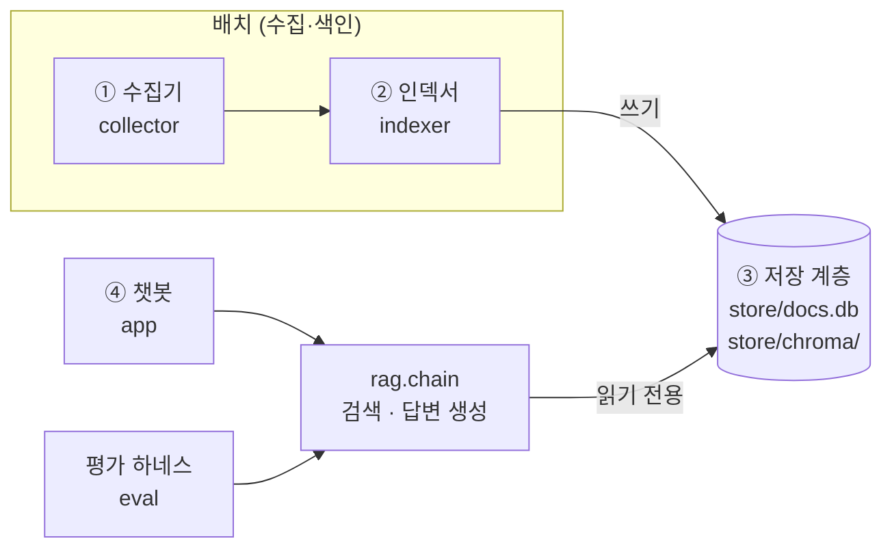
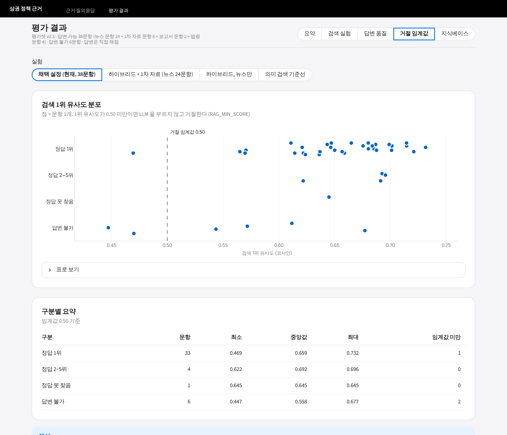
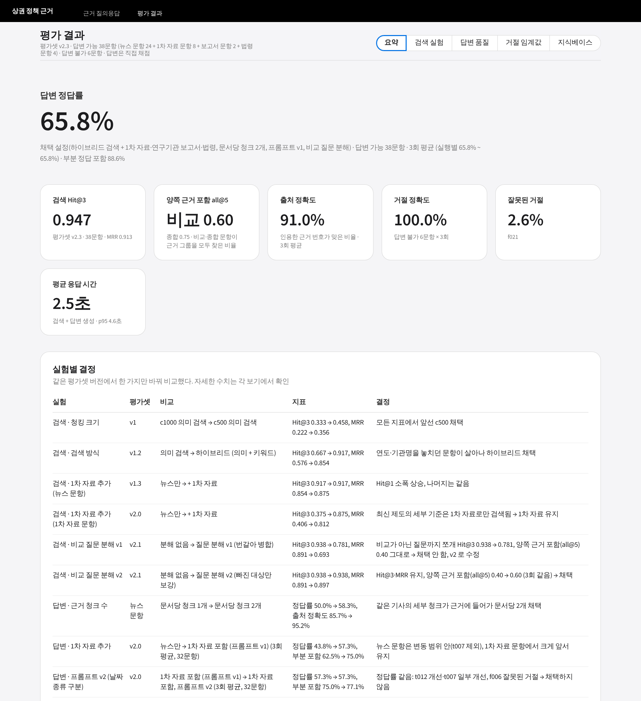
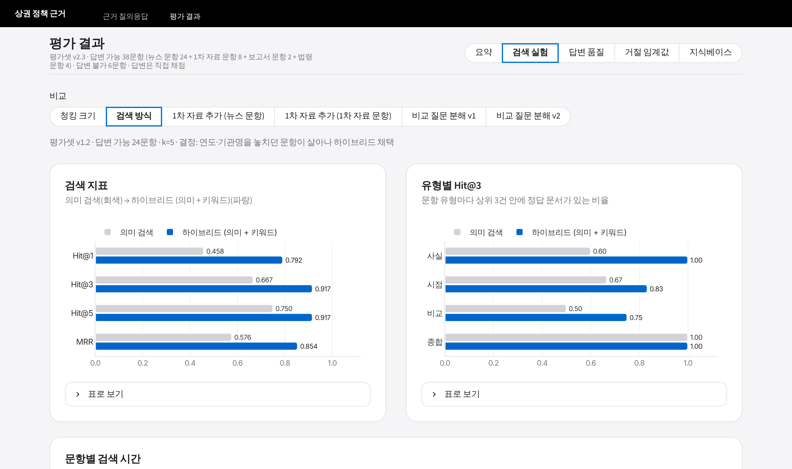
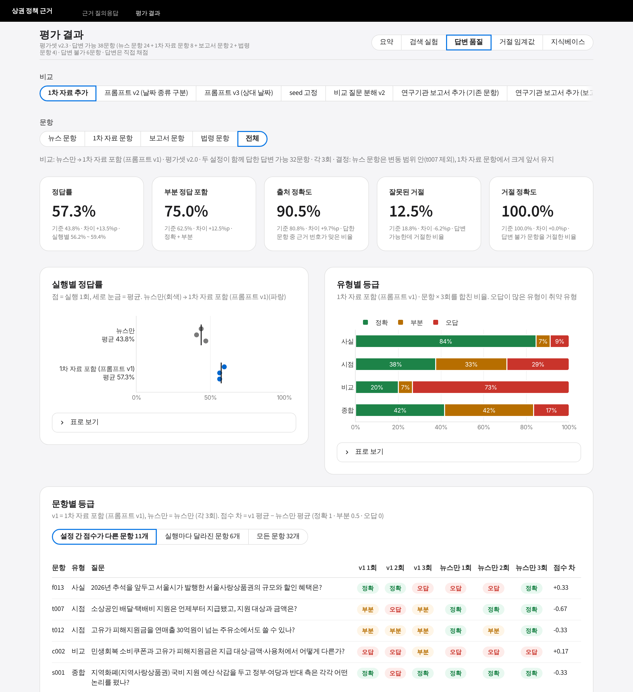

# 미니프로젝트 3 리포트 — 상권 정책 근거 질의응답 (RAG)

> 핵심 질문: **이 챗봇의 답변을 신뢰할 수 있는가. 그 판단의 근거는 무엇인가.**
> 모든 수치는 `eval/results/` 의 실험 결과 파일과 직접 채점(`answers.csv`)을 근거로 한다.
> 실험별 상세 표는 README '실험 기록', 시각화는 챗봇의 '평가 결과' 페이지(`app/dashboard.py`).

## 요약

| 항목 | 값 |
|---|---|
| 지식베이스 | 15,131건: 뉴스 14,397 · 정책브리핑 보도자료 487 · 서울시 공고 32 · 연구기관 보고서 11(상세 화면 요약·전문) · 법령 5개 현행 조문 204(국가법령정보센터 Open API, 조문 단위) |
| 채택 설정 | 하이브리드 검색(의미 + 키워드, RRF) · 500자 청크 · 문서당 근거 청크 2개 · 유사도 임계값 0.5 · gpt-4o-mini · 프롬프트 v1 · 비교 질문 분해(비교 표현이 있는 질문만) · 연구기관 보고서·법령 포함 |
| 검색 | 채택 설정 38문항 Hit@3 0.947 · MRR 0.913 (f031 정답 보정 후, 법령 문항 4개 중 3개는 조문이 1위) / 뉴스 문항 Hit@3 0.917 (v1.3) / 1차 자료 문항 Hit@3 0.875 (v2.0) / 양쪽 근거 포함(all@5) 비교 0.60 (분해 전 0.40) · 종합 0.75 (Hit@3 1.00) |
| 답변 (평가셋 v2.3, 38문항 × 3회 직접 채점) | 정답률 **65.8%** (3회 같음), 부분 정답 포함 88.6%, 출처 정확도 91.0%. 법령 문항 4개는 법령 포함 정확 6/12 (제외 0/12), 기존 34문항은 67.6%로 회귀 없음. 보고서 추가 전 설정과 같은 32문항으로는 61.5% → 62.5% |
| 거절 | 답변 불가 6문항 × 3회 모두 거절 (100%), 답변 가능한데 거절 2.6% (1문항, f021) · 평균 응답 2.5초 (p95 4.6초) |
| 유형별 정답률 | 사실 81% · 종합 50% · 시점 50% · 비교 40% (38문항) |
| 평가셋 밖 문항 (holdout, 14문항 × 3회 — 개발에 쓰기 전 측정, 이후 분해 v3 실험에 사용) | 정답률 75.0% (답변 가능 12문항, 사실 7/7), 답변 불가 2문항 모두 거절, 정답 보정 후 Hit@3 0.917. 실패 3문항(시점·비교·종합)은 개발용과 같은 유형 (6.5) |

**신뢰 판단.**
- **사실 확인은 근거로 쓸 수 있다.** 대상·금액·기준을 묻는 질문의 81%가 정확했다. 답변의 [번호]가 원문 문단과 연결되고, 인용한 근거가 맞은 비율은 91.0%다. 법령 조문은 조문 번호까지 출처에 보인다.
- **시점 변화와 비교 질문은 답변을 그대로 인용하면 안 된다.** 반드시 출처 원문과 대조해야 한다. 이 유형에서는 시점 혼동, 한쪽 대상의 핵심이 빠진 비교, 시점이 다른 근거로 답한 비교가 반복됐다.
- **근거가 없는 질문에는 수치를 지어내지 않았다.** 6문항 × 3회 모두 거절했다.
- **판단의 근거는 반복 측정이다.** 같은 설정을 3회 반복 실행해 실행 간 변동(정답률 ±1문항)을 쟀다. 설정 간 비교는 이 변동 폭과 문항별 일관성으로 판단했다.

## 1. 시스템 정의

- **대상 사용자**: 카드사 상권·가맹점 데이터 분석가
- **업무 상황**: 상권·가맹점 지표에서 변화나 이상치를 발견했을 때, 그 배경이 되는 정책·이슈를 근거 문서로 확인하고 분석 리포트에 인용한다
  - 예: 소비쿠폰 지급 주간의 매출 급증, 우대수수료율 변경 전후의 가맹점 구성 변화
- **범위**
  - 주제: 지역 상권·소상공인 정책 (주제 A)
  - 지역: 정책은 전국, 지자체 사업은 서울시·자치구
  - 업종: 전 업종 (카페·외식업은 미니프로젝트 2 와 이어지는 대표 시나리오)
  - 카드 결제 데이터 등 비공개 자료는 쓰지 않는다
- **대표 질문**: 평가셋에서 유형별로 골랐고, 결과는 채택 설정의 3회 실행 직접 채점이다. 챗봇 빈 화면의 예시 질문과 같다.

| 유형 | 질문 (id) | 결과 (3회) |
|---|---|---|
| 사실 · 1차 자료 | 2026년 상반기 우대수수료율이 적용되는 영세·중소 신용카드가맹점은 몇 개이고 전체의 몇 %인가? (f023) | 정확 3 (뉴스만: 오답 3) |
| 사실 · 카드 매출 | 한국신용데이터 분석에서 민생회복 소비쿠폰 지급 첫 주 소상공인 카드 매출은 어떻게 변했고, 가장 크게 늘어난 업종은? (f019) | 정확 3 |
| 시점 | 영세·중소가맹점 신용카드 우대수수료율은 2025년에 어떻게 바뀌었나? (t013) | 정확 3 (뉴스만: 오답 3) |
| 비교 | 중기부와 서울시의 자영업자 고용보험료 지원은 환급 비율과 기간이 어떻게 다른가? (c005) | 정확 3 (뉴스만: 오답 3) |
| 종합·판단 | 민생회복 소비쿠폰의 소비 진작 효과에 대해 어떤 긍정적 평가와 비판이 있나? (s005) | 정확 3 |
| 답변 불가 | 망원동 카페들의 월평균 카드 매출액은 얼마인가? (u001) | 거절 3 |

## 2. 지식베이스 구성

### 2.1 제공 데이터 탐색 (EDA, `notebooks/eda.ipynb`)

**제공 데이터 규모**
- 소상공인 묶음 뉴스 42,453건과 지역화폐 뉴스 36,888건, 합계 79,341건이다 (2021-10-16 ~ 2026-10-16).
- 두 묶음에 같이 들어 있는 기사 2,997건을 적재할 때 합쳐 **76,344건**을 적재했다.

**EDA에서 확인해 품질 필터·중복 처리 규칙으로 옮긴 것** (각 규칙의 근거는 `indexer/quality.py`·`dedup.py` 머리말)
- 본문 길이 중앙값은 947자다. 100자 미만은 515건(0.7%), 300자 미만은 2,734건(3.6%)이다. 100~300자 단신에도 할인율·예산 같은 사실 정보가 있다. 그래서 최소 길이를 100자로 낮게 잡았다.
- 5,000자 초과는 864건, 10,000자 초과는 205건이다. 최장 문서는 대부분 토론·회견 전문이다. 5,000~10,000자 구간에는 정상 장문 기사가 있다.
- 제목·리드에 주제어가 있는 기사는 67.7% 다. 주제어가 없는 기사는 표본 10건 중 8건이 주제와 무관했다.
- 광역 지자체명만으로는 '하남시는' 같은 기초 지자체 기사를 걸러내지 못한다.
- 매체마다 같은 보도자료를 다시 쓴 기사는 본문 유사도가 0.35~0.55에 머문다. 이 구간에 관점이 다른 분석 기사도 섞여 있어, 본문 유사도만으로는 중복을 가를 수 없다.

**부족한 영역**
- 제공 뉴스는 가이드 주제 A 키워드 15개 중 핵심 5개(소상공인 묶음)와 지역화폐(지역사랑상품권 대신)로만 수집됐다. 나머지 키워드는 본문에 나오는 건수만 셌다 (노트북 10번: 지역사랑상품권 7,059 · 소상공인시장진흥공단 2,321 · 상권활성화구역 307 · 젠트리피케이션 171건 등).
- 수치·기준의 원문(보도자료, 지원사업 공고)이 없어서, 기사가 옮긴 수치만 남는다. 기사는 시행 전 계획이나 개정 전 기준을 담는 경우가 많다.
- 분석가가 리포트에 인용하려면 '현행 기준의 원문'이 필요하다. 이것이 직접 수집의 근거다.

### 2.2 직접 수집 대상과 소스 탐색

수집 전에 후보 사이트마다 접근 가능 여부를 확인했다 (`python -m collector probe`): robots.txt 허용 여부, 응답, 본문이 HTML에 있는지, 첨부 파일 형식. 확인 결과와 대체 방안은 다음과 같다.

| 소스 | 확인 결과 | 판단 |
|---|---|---|
| 정책브리핑 보도자료 (korea.kr) | robots 허용. 목록은 정적 HTML이지만 상세 본문은 문서뷰어 iframe이라 HTML에 없음. 원문 PDF·HWPX 첨부는 내려받기 허용 | **주 수집원.** 부처 보도자료를 검색어·기간으로 찾고 **PDF 원문에서 본문 추출** |
| 중소벤처기업부 누리집 | 상세 링크가 일반 주소가 아님(`#view`) | 같은 보도자료가 정책브리핑에 있어 대체 |
| 서울시 보도자료 (seoul.go.kr/news) | **robots 금지** | 요청하지 않음 → 서울시 경제분야 누리집으로 대체 |
| 서울시 경제분야 누리집 | robots 허용. 정적 HTML (본문 `#post_content`) | '소기업·소상공인 종합지원 새소식' 수집 |
| 연구기관 보고서 (KDI·산업연구원·중소벤처기업연구원·조세재정연구원·서울연구원) | robots 허용. 기관별 검색 화면과 상세 화면 요약·전문은 HTML, PDF 내려받기 방식은 기관마다 다름 | 주제어 13개로 후보 282건 검색(`collector reports-search`) → 선별 기준(10~20건, 주제별 최대 4건)으로 **11건** 수집. 상세 화면의 요약·전문만 쓰고 PDF 는 받지 않음 |
| 국가법령정보센터 Open API | 인증값(OC) 발급 후 목록·본문 XML | 핵심 법령 5개 현행 조문 204건 수집 (조문 하나가 문서 하나, 여신전문금융업법은 제18조의3만). 크롤링이 아닌 공식 API |

**수집 원칙** (`collector/fetch.py` 가 강제한다)
- robots.txt 를 확인하고, 요청 간격은 1.5초 이상으로 둔다 (사이트가 정한 Crawl-delay 가 더 길면 그 값).
- User-Agent 를 명시하고, 실패하면 재시도한다.
- 이미 받은 문서는 건너뛰어 이어받기가 된다.
- API 인증값(법령 OC)은 `.env` 에만 두고, 화면 출력·오류 메시지·저장 원본에서 가린다.

**수집 쿼리** (정책브리핑, 제공 뉴스와 같은 기간)
- 중기부: '소상공인'
- 금융위: '카드수수료'
- 행안부: '지역사랑상품권'
- 제목 키워드로 주제 밖 보도자료를 걸렀다. 예: 카드수수료 검색에 섞여 나온 금융위 일반 보도자료.

**이용 조건**
- 정책브리핑은 공공누리 제1유형(출처 표시)이다.
- 서울시 누리집은 제4유형(출처 표시·비상업·변경 금지)이다.
- 챗봇은 모든 답변에 출처와 원문 링크를 표시한다. 원문을 고쳐 재배포하지 않는다.

**원문 파싱** (`indexer/parse.py`)
- PDF 는 PyMuPDF 로 읽는다. 두 쪽을 한 면에 모아 찍은 PDF 는 가운데를 가로지르는 단어가 없으면 좌우로 나눠 읽는다. 이 처리를 넣자 문장이 뒤섞이던 문제가 없어졌다.
- 쪽 번호 줄과 담당자 연락처 줄(직위·이름·직통 전화, 개인정보)은 지운다.
- **보일러플레이트 제거** (모든 문서): 뉴스 끝의 저작권 표기('ⓒ … 무단 전재 및 재배포 금지', 'All rights reserved', 'AI 학습 이용 금지')와
  폭 없는 문자를 지운다. 본문 문장을 지우지 않도록 표기 형태가 분명한 문구만 정규식으로 맞춘다.
- HWPX 는 구역 XML 을 문단 순서대로 읽는다.
- MuPDF 가 구조 오류를 고쳐 읽은 문서 351건은 경고로 남기고 본문을 썼다.

### 2.3 최종 문서 구성 (`python -m indexer prepare`)

| 종류 | 출처 신뢰도 | 수집 | 인덱싱 대상 | 비고 |
|---|---|---|---|---|
| 뉴스 | 언론 보도 | 76,344 | **14,397** | 전국 9,076 · 서울 5,321 |
| 보도자료 | 1차 자료 | 487 | **487** | 중기부 451 · 금융위 18 · 행안부 18 (PDF 484 · HWPX 3) |
| 서울시 공고 | 1차 자료 | 36 | **32** | 100자 미만 4건 제외 |
| 연구기관 보고서 | 1차 자료 | 11 | **11** | KDI 3 · 중기연 4 · 서울연구원 4 (요약 9 · 전문 2) |
| 법령 조문 | 1차 자료 | 204 | **204** | 지역상권법 39 · 전통시장법 107 · 지역사랑상품권법 24 · 상가임대차법 33 · 여신전문금융업법 1 |
| 합계 | | 77,082 | **15,131** | 청크 55,584개 (c500, 문서당 평균 3.7개) |

### 2.4 커버리지의 한계

**수집하지 못한 1차 자료**
- 2021-10~12 에 몰린 옛 HWP 전용 보도자료 26건 (손실보상·방역지원금 등). HWP5 바이너리 파서가 없다.
- 첨부 없이 문서뷰어에만 본문이 있는 보도자료 7건.
- 블로그는 제외했다. 분석가가 리포트에 인용할 근거로 쓰기 어렵고, 신뢰도가 가장 낮아 별도 필터와 검증이 필요하며,
  블로그로만 답할 수 있는 평가 문항이 없어 효과를 잴 수 없기 때문이다.

**구성 편향**
- 인덱싱 대상의 95.1%가 뉴스다 (14,397 / 15,131). 그래서 검색 상위에 1차 자료가 드는 경우가 적다. 평가셋을 뉴스로 먼저 만들었을 때 상위 5건에 보도자료가 든 문항은 30문항 중 5개였다.
- 서울시 지원사업은 경제분야 누리집 한 카테고리(32건)뿐이다. 자치구 사업은 거의 없다.

## 3. 파이프라인 설계

**계층 구조**
- 수집 → 색인은 배치로 돌고, 챗봇은 저장 계층을 읽기만 한다. 원문 DB 는 SQLite 읽기 전용 모드로 열고, 임베딩은 질문을 벡터로 바꾸는 데만 쓴다.
- **챗봇과 평가 하네스는 같은 `rag.chain` 을 호출한다.** 평가한 체인과 서비스하는 체인이 같아야 평가 수치가 서비스 품질을 대변한다.
- 계층 간 금지된 import 는 `tests/test_layer_boundaries.py` 가 정적으로 검사한다. 예: app → indexer, rag → collector.

**청크 메타데이터** (`common/schema.CHUNK_METADATA_FIELDS`)

| 항목 | 쓰임 |
|---|---|
| `doc_id`, `chunk_id`, `chunk_index` | 원문 조회(원문 확인 창), 같은 문서의 청크를 기사 순서대로 이어 붙이는 근거 확장 |
| `title`, `source`, `url`, `published_at` | 답변의 번호별 출처 표시 (제목·발행처·발행일·원문 링크) |
| `published_ymd` (정수) | 기간 필터. Chroma 의 `$gte`/`$lte` 는 숫자에만 동작하므로 YYYYMMDD 정수로 따로 저장 (발행일 미상은 0) |
| `doc_type`, `source_tier` | 출처 종류 필터, 프롬프트의 '출처 종류를 밝힌다' 규칙, 화면의 신뢰도 배지(1차 자료 / 언론 보도) |
| `scope` | 뉴스의 서울/전국 구분 (범위 규칙 결과) |
| `collected_at` | 수집 일시 기록 (가이드 점검 항목) |

**거절은 두 단계로 한다.**
1. 검색 1위 유사도가 0.5 미만이면 LLM 을 부르지 않고 거절한다.
2. 근거가 있어도 답할 내용이 없으면 프롬프트 규칙에 따라 정해진 문구로만 거절한다.

부분 답변에는 다른 문구를 쓰게 해서, 거절과 부분 답변을 기계적으로 구분한다.

## 4. 문서 처리

### 4.1 품질 필터와 중복 처리 (처리 전후 건수)

전체 77,082건을 품질 필터와 중복 처리에 차례로 통과시켰다. 연구기관 보고서·법령은 선별 수집이라 품질 필터 대상이 아니다.

| 단계 | 사유 | 건수 |
|---|---|---|
| 품질 제외 | 서울 외 지자체 단독 사업 (`outside_seoul`) | 32,283 |
| | 주제 무관 (`off_topic`) | 24,180 |
| | 본문 과소 (`too_short`, 뉴스 100자 · 공고 100자 · 보도자료 200자 미만) | 555 |
| | 정보량 부족 (`low_information`) | 484 |
| | 토론·회견 전문 등 과대 (`too_long`) | 199 |
| | 녹취록 (`transcript`) | 24 |
| 중복 | 대표 문서로 대체 | 4,226 |
| **유지** | | **15,131** |

**중복 기준** (`indexer/dedup.py`, v2)
- **완전 중복**: 정규화한 본문이 같으면 대표 1건만 남긴다.
- **재배포본**: 공백·기호를 뗀 본문의 문자 5-gram Jaccard 유사도가 0.8 이상이면 같은 기사로 본다. 재배포는 수일 안에 일어나므로 발행일 차이 3일 이내인 쌍만 비교한다.
- **같은 보도자료를 옮긴 기사**: 본문 유사도가 0.3 이상이면서 제목 유사도도 0.3 이상인 경우다. EDA 에서 본 0.35~0.55 구간의 재작성 기사를 잡기 위한 기준이다.
- **동일 사건이지만 관점이 다른 분석·해설**: 제목이 다르면 유지한다. 상충 근거를 지우지 않기 위해서다.
- **대표 문서 선택 순서**: 1차 자료 > 이를 옮긴 뉴스 → 본문이 긴 쪽 → 먼저 발행된 쪽. 보도자료를 거의 그대로 옮긴 뉴스는 보도자료로 대체된다.
- **법령은 중복 처리에서 뺀다.** 같은 법의 조문은 시행일이 같고 제목('법령명 제n조')이 닮아 '같은 보도자료 기사' 규칙에 걸릴 수 있다.

### 4.2 청킹 전략과 선택 근거

**비교 조건**
- 같은 평가셋(v1, 답변 가능 24문항)·같은 의미 검색으로 두 설정을 비교했다.
- 분할은 `RecursiveCharacterTextSplitter` 로 하고, 문단 → 문장 → 공백 순으로 자른다.
- 청크마다 제목 한 줄과 빈 줄을 머리말로 붙인다. 짧은 청크도 무엇에 관한 내용인지 드러나게 하기 위해서다.

| 설정 | 청크 크기 / 겹침 | 청크 수 | Hit@1 | Hit@3 | Hit@5 | MRR |
|---|---|---|---|---|---|---|
| c1000 | 1,000 / 150자 | 26,816 | 0.083 | 0.333 | 0.458 | 0.222 |
| **c500 (채택)** | 500 / 100자 | 50,594 | 0.208 | 0.458 | 0.583 | 0.356 |

- **c500 이 모든 지표에서 앞섰다.** 기사 한 건에 여러 사업·수치가 섞인 경우가 많아서, 큰 청크에서는 질문과 관련된 문장의 비중이 희석된다.
- **c500 으로 생기는 근거 부족은 생성 단계에서 보완했다.** 청크가 짧으면 답에 필요한 세부가 같은 기사의 다른 청크에 있을 수 있다. 그래서 '문서당 근거 청크 2개' 실험을 했다 (7장).
- 1차 자료를 추가한 뒤 청크는 55,332개, 보고서·법령까지 더한 최종 지식베이스는 55,584개다 (본문 중앙값 450자, 100자 미만 39개 · 0.1%). 법령은 수집 단계에서 조문 하나를 문서 하나로 저장해 조문 단위로 나뉜다 (조문 길이 중앙값 약 330자라 대부분 청크 1개).

**인덱싱 검증** (`python -m indexer verify --collection docs__c500`, 최종 지식베이스, 2026-11-09)
- 청크 55,584개 · 문서 15,131건. 인덱싱 대상(`processed_documents` 유지 문서) 15,131건과 비교해 누락 0건, 빈 청크 0개.
- 출처 추적 메타데이터가 빈 문서 0건: 문서 종류·출처·제목·URL·발행일·수집 일시 모두 15,131건에 값이 있다.
- 컬렉션 메타데이터: `text-embedding-3-small`, 500자 / 겹침 100자, 제목 머리말 포함 (검색기가 열 때 이 모델 이름을 확인한다).
- 샘플 검색 3개는 모두 주제가 맞는 기사를 상위에 올렸다 (예: '서울 골목상권 매출 변화' → 2023-10 '서울 골목상권 매출 활황' 0.833).
  검증은 청크 단위 검색이라 같은 기사의 청크가 여러 번 나온다. 챗봇·평가의 검색기(`rag/retriever.py`)는 문서당 가장 유사한 청크 1개로
  순위를 매기고, 같은 날 같은 제목의 기사도 하나만 남긴다.

### 4.3 임베딩과 생성 모델

- **임베딩**: OpenAI `text-embedding-3-small`.
  - 한국어 문서를 형태소 분석 없이 바로 쓸 수 있고, 5만여 청크를 적재하는 비용이 낮다.
  - 색인과 질문에 같은 모델을 쓰도록 생성 지점을 하나로 두었다. 모델 이름을 컬렉션 메타데이터에 기록하고, 검색기가 열 때 현재 설정과 다르면 오류를 낸다.
  - **`text-embedding-3-large` 와 비교했다** (같은 c500 청크, 평가셋 v2.3 38문항, 질문 분해 끔, `...-emb-*`). 실행 전 기준은
    '하이브리드 Hit@3 가 large 에서 2문항 이상 오르고 MRR 이 떨어지지 않으면 large'였다.

| 지표 (38문항, 정답 보정 전) | small (채택) | large |
|---|---|---|
| 의미 검색만 Hit@3 · MRR | 0.763 · 0.686 | 0.763 · 0.645 |
| 하이브리드 Hit@3 · MRR | **0.947 · 0.908** | 0.842 · 0.772 |
| 하이브리드 양쪽 근거 포함 all@5 (비교 · 종합) | 0.40 · 0.75 | 0.40 · 0.50 |
| 상위 3건 중 판정하지 않은 문서 (하이브리드) | 9건 | 40건 |
| 인덱스 임베딩 비용 (입력 26,068,564 토큰) | 약 $0.52 | 약 $3.39 (6.5배) |
| 벡터 차원 | 1,536 | 3,072 |

  - large 는 정답 목록에 없는 새 문서를 더 많이 올려(40건 vs 9건) 판정 전 수치로는 불리하다. 그래도 기준은 판정과 관계없이 넘을 수 없다.
    large 가 하이브리드 상위 3건에서 놓친 6문항 중 f016 은 상위 3건이 모두 이미 '정답 아님'으로 판정된 문서라, 나머지를 전부 정답으로
    판정해도 large 는 37/38 이고 small(36/38)보다 1문항 많을 뿐이다.
  - **small 을 유지한다.** 검색 품질은 같거나 더 낫고, 비용은 1/6.5, 벡터 크기는 절반이다. large 가 c001·c002 에서 올린 문서
    (예: '[전쟁 추경] 소득하위 70%에 최대 60만원')는 정답일 수 있어, 판정하면 차이는 줄어든다. 생성 모델(gpt-4o-mini)은 비교하지 않았다.
- **키워드 검색**: 의미 검색이 놓친 연도·기관명·수치를 보완한다 (7장).
  - SQLite FTS5 BM25 로 구현하고, 색인어는 한글 2-gram 과 숫자다.
  - 제목 일치에 가중치 2를 준다.
- **생성**: `gpt-4o-mini`, temperature 0. 근거 문서에만 의존하도록 규칙 8개를 프롬프트에 둔다 (`rag/prompts.py`). 버전은 v1 이다.

## 5. 평가셋 설계

**구성 의도**
- 챗봇을 만들기 전에 작성했다.
- 문항마다 정답 문서 목록(`gold_doc_ids`)과 채점 기준(`answer_key`)을 둔다. 채점 기준에는 핵심 수치·시점과, 혼동하면 오답이 되는 값을 적는다.
- 문항은 분석가가 실제로 물을 법한 질문이다. 지표 변화의 배경이 된 정책의 규모·조건·시점을 묻는다.

| 유형 | 문항 | 검증 대상 |
|---|---|---|
| 사실 (`fact`) | 21 | 기본 검색 정확도 (그중 1차 자료 문항 5 · 보고서 문항 2 · 법령 문항 4) |
| 시점 (`temporal`) | 8 | 발행일 활용 — 5년 지식베이스에서 정책이 언제 어떻게 바뀌었는지 |
| 비교 (`comparison`) | 5 | 복수 문서 종합 |
| 종합 (`synthesis`) | 4 | 상충 근거를 양쪽 모두 제시 |
| 답변 불가 (`unanswerable`) | 6 | 근거가 없을 때 거절 |
| **합계 (v2.3)** | **44** | 답변 가능 38 (뉴스로 만든 24 + 1차 자료 8 + 연구기관 보고서 2 + 법령 4) |

**답변 불가 문항을 넣은 이유**
- 분석가 질문 중 상당수는 지식베이스에 답이 없다. 비공개 카드 매출, 미래 예측치, 수집 범위 밖 지역이 그렇다.
- 이때 그럴듯한 수치를 지어내면 리포트에 잘못된 근거가 들어간다.
- 문항은 네 가지 유형으로 만들었다.
  - 비공개 데이터: u001 망원동 카페 매출, u005 권리금 시세
  - 미래 예측: u002·u008
  - 범위 밖 지역: u003 부산 동래구
  - 근거 없이 답하라는 유도: u009
- 거절 정확도는 이 6문항으로 따로 잰다.

**정답 문서 보정 (pooling, `eval/pool.py`)**
- 처음 적은 정답 목록만으로 채점하면, 관련 문서를 찾아도 목록에 없으면 오답이 된다.
- 기준선과 하이브리드의 상위 3건 중 목록 밖 문서 83건을 직접 판정했다. 27건(13문항)을 정답에 추가하고 56건은 '정답 아님'으로 기록했다 (v1.1).
- 두 실험의 결과를 함께 판정해, 한쪽에 유리하지 않게 했다.
- 이후 판정 오류 수정(v1.2), 1차 자료 추가 후 보정(v1.3), 1차 자료 문항 8개 추가(v2.0), 비교 문항의 대상별 정답(v2.1),
  보고서 문항 2개(v2.2), 법령 문항 4개(v2.3)를 거쳤다. 보고서·법령 문항은 수집한 본문을 읽고 그 자료에만 있는 내용으로 만들었고,
  같은 내용을 옮긴 문서는 실행 결과로 정답에 보탰다 (f028 뉴스 3건, f031 개정 보도자료·기사 2건 — 숫자가 없는 정답 기준이라 전문으로 판정).
- **버전이 다르면 수치를 직접 비교하지 않는다.**

**답변 채점**
- 모든 답변은 직접 채점했다: 정확 / 부분 / 오답, 그리고 인용한 출처가 맞는지(Y/N).
- 같은 문항에 같은 답변 문장이 다시 나오면 이전 채점을 옮겨 쓴다 (`eval.grade carry`). 같은 답이 다르게 채점되는 일을 막기 위해서다.

## 6. 평가 결과

### 6.1 기준 설정과 채택 설정

| 지표 | 기준선 (c500 의미 검색, v1.2) | 채택 설정 (하이브리드 + 1차 자료, v1.3) |
|---|---|---|
| Hit@1 | 0.458 | 0.833 |
| Hit@3 | 0.667 | 0.917 |
| Hit@5 | 0.750 | 0.917 |
| MRR | 0.576 | 0.875 |
| 평균 검색 시간 | 235ms | 420ms |

1차 자료 문항 8개(v2.0)의 검색 지표는 다음과 같다.
- 채택 설정: Hit@3 0.875 · MRR 0.812
- 같은 컬렉션에서 1차 자료를 빼고 검색했을 때: Hit@3 0.375 · MRR 0.406

연구기관 보고서·법령을 더한 뒤에도 기존 34문항의 검색은 그대로다 (Hit@3 0.941 · MRR 0.903, 3회 같음). 법령 문항은 f030·f032·f033
의 조문이 1위로 검색된다. f031 은 조문이 같은 주제의 개정 보도에 밀려 상위 5건 밖이지만, 개정 내용을 모두 담은 보도자료·기사가 1·2위다
(정답 보정 후 38문항 Hit@3 0.947 · MRR 0.913).

비교 질문 분해(채택)는 평가셋 v2.1 의 답변 가능 32문항에서 Hit@3 0.938 · MRR 0.891 → 0.897 로 순위를 유지하고, 비교 문항의
양쪽 근거 포함(all@5)을 0.40 → 0.60 으로 올렸다 (7장 6). 비교 표현이 없는 질문의 검색 결과는 분해 전과 같다.

### 6.2 답변 품질 (채택 설정, 38문항 × 3회)

| 실행 | 정확 / 부분 / 오답 | 정답률 | 출처 정확도 | 거절 정확도 | 잘못된 거절 |
|---|---|---|---|---|---|
| 1회 | 25 / 8 / 5 | 65.8% | 89.2% | 100% | 2.6% |
| 2회 | 25 / 9 / 4 | 65.8% | 91.9% | 100% | 2.6% |
| 3회 | 25 / 9 / 4 | 65.8% | 91.9% | 100% | 2.6% |
| **평균** | 25.0 / 8.7 / 4.3 | **65.8%** | **91.0%** | **100%** | **2.6%** |

- 채택 설정은 하이브리드 검색 + 1차 자료·연구기관 보고서·법령, 문서당 청크 2개, 프롬프트 v1, 비교 질문 분해다 (`...-kb4-r1~r3`).
- 단계별로는 32문항 57.3%(1차 자료) → 61.5%(분해) → 62.5%(보고서), 34문항 64.7%(보고서) → 67.6%(법령 추가 후 같은 34문항, 실행 간 변동 범위)다.
  보고서·법령 문항을 더한 38문항은 65.8% 다 (7장).
- 평균 응답 시간은 검색과 생성을 합쳐 2.5초다 (p95 4.6초). 비교 표현이 있는 질문에만 분해 LLM 호출이 더해진다.
- 잘못된 거절은 f021 하나다. 정답 보도자료를 1위로 찾지만 1위 유사도가 0.47 로 임계값 미만이다 (8장).
- 분해 전 잘못된 거절이던 t011·c003 은 거절 대신 시점이 다른 근거로 틀린 답을 한다 (8장). 등급은 같은 오답이지만 사용자에게는 더 위험한 실패다.

### 6.3 질문 유형별 정확도 (문항 × 3회 합산)

| 유형 | 정확 | 부분 | 오답 | 정답률 | 검색 Hit@3 (채택 설정, v2.3) |
|---|---|---|---|---|---|
| 사실 | 51 | 8 | 4 | 81% | 0.95 |
| 종합 | 6 | 6 | 0 | 50% | 1.00 |
| 시점 | 12 | 6 | 6 | 50% | 0.88 |
| 비교 | 6 | 6 | 3 | 40% | 0.80 |

- 사실 문항은 검색과 답변 모두 안정적이다.
- **종합 문항의 검색 지표(1.00)는 포화돼 있다.** 한쪽 근거만 찾아도 정답으로 집계되기 때문이다. 정답 문서를 입장별로 나눠 다시 채점하면 양쪽 근거를 모두 찾은 문항은 4개 중 3개(all@5 0.75)다. s004 는 유지 측 근거(소상공인 단체·노동계)를 3회 모두 찾지 못했고, 이것이 답변의 '유지 측 누락'(부분 3회)으로 이어졌다. s006 은 양쪽을 다 찾고도 시점 혼동으로 부분이었다.
- **약점은 시점과 비교다.**
  - 시점: 검색은 되지만 생성 단계에서 시점이 섞인다 (t009·s006). 사실 문항의 f031 도 같은 유형의 시점 혼동이다.
  - 비교: 분해로 양쪽 근거를 찾게 돼 20% → 40% (부분 포함 80%)가 됐다. 남은 실패는 한쪽 핵심 누락(c001·c004)과 시점이 다른 근거(c003)다.

### 6.4 거절 임계값의 근거

| 구분 (채택 설정, 평가셋 v2.3) | 문항 | 1위 유사도 범위 | 0.5 미만 |
|---|---|---|---|
| 정답이 1위 | 33 | 0.469 ~ 0.732 | 1 (f021) |
| 정답이 2~5위 | 4 | 0.622 ~ 0.696 | 0 |
| 정답을 상위 5건에서 못 찾음 | 1 | 0.645 | 0 |
| 답변 불가 | 6 | 0.447 ~ 0.677 | 2 (u005·u009) |

- 임계값 0.5 는 뉴스 24문항 시점(평가셋 v1.2)의 1위 유사도 분포를 보고 정했다. 그때는 답변 가능 문항이 하나도 걸리지 않았다 (최솟값 0.570).
  - 최종 설정에서는 1차 자료 문항 f021(0.4695)이 걸린다. 정답 보도자료를 1위로 찾고도 검색 단계에서 거절한다 (8장).
- **유사도만으로는 답변 불가를 가를 수 없다.** 답변 불가 질문도 주제가 비슷한 기사가 검색되기 때문에, 답변 불가 6문항 중 4개가 0.5 이상이다 (최댓값 0.677).
  f021(0.4695)과 u005(0.470)는 사실상 같은 값이라 임계값을 조정해도 둘을 가를 수 없다.
- 답변 불가를 모두 유사도로 거르려면 임계값이 0.68 을 넘어야 한다. 그러면 답변 가능 38문항 중 21개(중앙값 0.662)가 함께 거절된다.
- 그래서 나머지는 생성 단계의 거절 규칙이 막는다. 실제로 3회 모두 6문항 전부 거절했다.

### 6.5 평가셋 밖 문항 (holdout, `eval/holdout.jsonl`)

44문항은 검색 방식·프롬프트·질문 분해를 고치는 데 쓴 개발용 평가셋이다. 채택 설정이 새 질문에서도 같은 수준인지 보려고, 개발에
쓰지 않은 14문항을 새로 만들어 채택 설정 그대로 3회 쟀다. 개발용 문항을 바꿔 쓴 질문은 넣지 않았고, 정답 문서는 개발용 정답과
1건만 겹친다. 정답 기준은 '필수 / 참고 / 부분·오답 조건'으로 썼고, 결과를 보고 시스템을 고치지 않았다.

| 구분 | 개발용 (44문항, 답변 가능 38) | 평가셋 밖 (14문항, 답변 가능 12) |
|---|---|---|
| 정답률 (3회) | 65.8% | **75.0%** (3회 같음) |
| 부분 정답 포함 | 88.6% | 83.3 ~ 91.7% |
| 출처 정확도 | 91.0% | 83.3% |
| 답변 불가 거절 | 100% | 100% (2문항) |
| 유형별 정답률 | 사실 81 · 시점 50 · 비교 40 · 종합 50% | 사실 100 (7문항) · 시점 50 · 비교 50 · 종합 0% (부분 3회) |
| 검색 Hit@3 · MRR | 0.947 · 0.913 (정답 보정 후) | 0.667 · 0.649 → 정답 보정 후 0.917 · 0.836 |
| 양쪽 근거 포함 all@5 | 비교 0.60 · 종합 0.75 | 비교 1.00 · 종합 0.00 |

- 전체 정답률이 개발용보다 높은 것은 12문항 중 7문항이 사실 문항이기 때문이다. 1문항이 8%p 라 '더 좋다'고 읽을 수 없고,
  **유형별 경향(사실은 강하고 시점·비교·종합은 약함)이 새 질문에서도 그대로 나타난 것**으로 읽는다
- 정답 보정은 개발용과 같은 방식(상위 결과를 전문으로 판정)으로 했다. 보정 전 Hit@3 0.667 은 같은 내용을 담은 다른 시기 기사
  (h05 의 2025-12 법 개정 기사 등)가 정답 목록에 없던 탓이었다
- 실패 3문항은 개발용에서 본 실패와 같은 유형이다
  - h08 (2026년 지역화폐 국비): 2026년 예산을 '내년'으로 쓴 2025-12 확정 기사는 검색되지 않았다 (t011 과 같은 상대 날짜 문제).
    대신 검색된 2026-09 기사에 2026년 1조1500억원과 2027년 예산안 1조4500억원이 함께 있었고, 2회는 2027년 값을 골랐다 (시점 혼동)
  - h11 (온누리 vs 지역사랑): 근거 그룹은 양쪽 다 찾았지만 '행정안전부가 발행을 지원하는 지역사랑상품권'을 발행 주체로 읽었다.
    발행 주체를 정한 법령 조문은 상위 5건에 없었다 (f031 처럼 같은 주제 기사에 조문이 밀림)
  - h13 (고유가 지원금 효과): 정부 분석(매출 10.6%) 기사만 찾고 현장의 한계('초반만 반짝', '효과 제한적') 기사는 찾지 못했다
    (종합 all@5 0.00). 답변은 '한계'로 지역별 증가율 차이와 주유소 사용 제한 논란을 들었는데, 둘 다 효과의 한계가 아니다 (s004 와 같은
    한쪽 입장 누락)

### 6.6 시각화 (`app/dashboard.py`)

대시보드는 같은 평가셋 버전끼리 짝지은 실험만 비교한다. 차트마다 같은 값을 담은 표 보기가 있다.

| 요약 | 검색 실험 (검색 방식) |
|---|---|
|  |  |

## 7. 개선 내역

**원칙**
- 실패 분석으로 원인 계층을 정하고, 한 번에 한 변수만 바꿔 같은 평가셋 버전에서 재측정했다.
- 답변 실험은 같은 설정을 3회 반복 실행한 평균과 문항별 일관성으로 비교했다. 같은 설정·temperature 0 에서도 답변 가능 24문항 중 5~6문항의 등급이 실행마다 달라졌기 때문이다.

| 실험 태그 | 변경 사항 (단일 변수) | 평가셋 | Hit@1 | Hit@3 | MRR | 정답률 | 거절 정확도 |
|---|---|---|---|---|---|---|---|
| `baseline-c500` | 기준선: c500 의미 검색 | v1 | 0.208 | 0.458 | 0.356 | — | — |
| `baseline-c1000` | 청크 1000자 | v1 | 0.083 | 0.333 | 0.222 | — | — |
| `hybrid-c500` | 하이브리드 검색 | v1 | 0.542 | 0.667 | 0.599 | — | — |
| `baseline-c500-v1.2` | (정답 보정 후 기준선) | v1.2 | 0.458 | 0.667 | 0.576 | — | — |
| `hybrid-c500-v1.2` | 하이브리드 검색 | v1.2 | 0.792 | 0.917 | 0.854 | — | — |
| `hybrid-c500-answers` | 답변 생성 (문서당 청크 1개) | v1.2 | 0.792 | 0.917 | 0.854 | 50.0% (24) | 100% |
| `hybrid-c500-ctx2-answers` | 문서당 근거 청크 2개 | v1.2 | 0.792 | 0.917 | 0.854 | 58.3% (24) | 100% |
| `…-ctx2-news-r1~r3` | (1차 자료 제외, 3회) | v1.3·v2.0 | 0.792 | 0.917 | 0.854 | 43.8% (32) | 100% |
| `…-ctx2-kb2-…` (3회) | **1차 자료 추가 (채택)** | v1.3·v2.0 | 0.833 | 0.917 | 0.875 | **57.3% (32)** | 100% |
| `…-kb2-p2-r1~r3` | 프롬프트 v2 (날짜 종류 구분) | v2.0 | — | — | — | 57.3% (32) | 100% |
| `…-kb2-p3-r1~r3` | 프롬프트 v3 (상대 날짜) | v2.0 | — | — | — | 60.4% (32) | 100% |
| `…-kb2-p2-seed-r1~r3` | seed 42 고정 | v2.0 | — | — | — | 58.3% (32) | 100% |
| `…-kb2-v2.1` | (분해 없음, 다시 채점) | v2.1 | 0.844 | 0.938 | 0.891 | — | — |
| `…-kb2-dec-r1~r3` | 비교 질문 분해 v1 (번갈아 병합) | v2.1 | 0.59 ~ 0.63 | 0.781 | 0.69 ~ 0.71 | — | — |
| `…-kb2-dec2-r1~r3` | **비교 질문 분해 v2 (채택)** | v2.1 | 0.81 ~ 0.84 | 0.91 ~ 0.94 | 0.87 ~ 0.90 | **61.5% (32)** | 100% |
| `…-kb3-r1~r3` | **연구기관 보고서 추가 (채택)** | v2.2 | 0.79 ~ 0.82 | 0.88 ~ 0.91 | 0.84 ~ 0.87 | **64.7% (34)** | 100% |
| `…-kb3-yw-r1~r3` | 분해 보강 문서를 질문 연도 ±1년으로 제한 | v2.2 | 0.853 | 0.941 | 0.903 | — (미채택) | — |
| `…-kb3-dates-r1~r3` | 상대 날짜 정규화 (색인 단계) | v2.2 | 0.853 | 0.941 | 0.898 | — (미채택) | — |
| `…-kb3-ad-r1~r3` | 상대 날짜를 답변 근거에만 | v2.2 | 0.853 | 0.941 | 0.903 | 67.6% (34) (미채택) | 100% |
| `…-kb4-r1~r3` | **법령 추가 (채택)** | v2.3 | 0.842 (보정 후 0.868) | 0.921 (0.947) | 0.887 (0.913) | **65.8% (38)** · 기존 34문항 67.6% | 100% |
| `…-kb4-st-r1~r3` | 종합 질문 입장별 분해 (분해 v3) | v2.3 | 0.868 | 0.947 | 0.913 | — (미채택) | — |
| `…-emb-small/large-hybrid` | 임베딩 모델 small → large (분해 끔, 정답 보정 전) | v2.3 | 0.868 → 0.684 | 0.947 → 0.842 | 0.908 → 0.772 | — (small 유지) | — |

- 검색 지표는 답변 가능 24문항(뉴스 문항) 기준이다. 1차 자료 문항 8개는 6.1 에 따로 적었다.
- 정답률의 괄호는 답변 가능 문항 수다. (32)는 뉴스 문항 24(v1.3)와 1차 자료 문항 8(v2.0)을 합친 3회 평균이다.
- 프롬프트·seed 실험은 검색 설정이 채택 설정과 같아 검색 지표를 적지 않았다.
- v2.1 행(분해 실험)의 검색 지표는 답변 가능 32문항 기준이다. v2.1 은 v2.0 에 비교 문항의 대상별 정답 문서만 더한 것이다.
- v2.2 행은 답변 가능 34문항, v2.3 행은 38문항 기준이다. 보고서 실행(`kb3`)과 뒤 실험의 Hit@3 차이(0.88~0.91 → 0.94)는 f021 의
  임베딩 순위 흔들림과 f028 정답 보정 때문이고 검색이 바뀐 것이 아니다. 미채택 실험 중 세 개는 기준에서 결론이 나 전체 채점을 하지 않았다

1. **실패 분석 → 하이브리드 검색** (검색 계층)
   - 기준선의 Hit@3 실패 13문항을 원인별로 나눴다: 질문의 연도·기관명 무시 5, 비교 문항에서 한쪽만 검색 2, 관련 기사를 찾았지만 정답 목록에 없음 5, 기타 2.
   - 의미 검색은 '2027년도 예산안'에 2024년 예산 기사를, '중기부 예산'에 정부 전체 예산 기사를 올렸다. 그래서 키워드 검색(BM25)을 더해 문서 단위 순위로 RRF 결합했다.
   - v1.2 기준 Hit@3 은 0.667 → 0.917 (+0.250), MRR 은 0.576 → 0.854 로 올랐다. 유형별 Hit@3 은 사실 0.6 → 1.0, 시점 0.67 → 0.83, 비교 0.5 → 0.75 다. 검색 시간은 +140ms 늘었다.
   - 고유명사·수치 질문 (가이드 2-2 의 측정 대상): 질문에 숫자(연도·금액·월)나 기관명(중기부·서울시·정부 등)이 있는 14문항은 Hit@3 0.643 → 0.857,
     MRR 0.524 → 0.786 이다. f006(중기부 2027년도 예산안)·f007(중기부 2026년 6월 선정)·f013(2026년 추석 서울사랑상품권)이 상위 3건 밖에서
     안으로 들어왔다. 남은 실패 t011·c003 도 연도가 있는 질문이지만, 정답 기사가 그 해를 '내년'으로 써서 키워드가 맞지 않는다 (8장).
     없는 10문항도 0.70 → 1.00 으로 올라, 키워드 검색이 고유명사·수치에만 듣는 것은 아니었다. 분류는 질문 문자열 기준의 기계적 규칙이다.
   - '정답 목록에 없음' 5건은 정답 보정(5장)으로 다뤘다.
2. **문서당 근거 청크 2개** (생성 계층)
   - 청크 1개만 근거로 넣었을 때 같은 기사의 다른 청크에 있던 세부가 빠졌다. 예: f006 은 예산 총액만 근거에 들어가 구성이 빠졌다.
   - 임계값을 통과한 문서마다 질문과 유사한 청크를 하나 더 기사 순서대로 붙였다. 검색 순위는 그대로 두었다.
   - 정답률은 50.0% → 58.3%, 출처 정확도는 85.7% → 95.2% 로 올랐다.
   - 대신 t009 가 부분 → 오답으로 나빠졌다. 늘어난 2026년 근거를 2025년 사업으로 기술한 시점 혼동이다.
3. **1차 자료 추가** (데이터 계층)
   - 1차 자료를 뺀 설정과 각 3회 비교했다. 같은 컬렉션에서 `--doc-types news` 로 검색 대상만 거른 것이다.
   - 뉴스로 만든 24문항: 정답률 54.2% vs 47.2%, 부분 포함은 둘 다 70.8% 였다.
     - 일관되게 나빠진 문항은 t007 하나뿐이다 (8장).
     - 나머지 차이는 실행 간 변동 범위 안이다.
   - 1차 자료로 만든 8문항: 87.5% vs 12.5% 다.
     - 뉴스만으로는 최신 제도의 세부 기준을 정확히 답하지 못했다.
     - 우대수수료 대상 가맹점 수(f023), 비즈플러스카드 신용점수 기준(t014), 고용보험료 환급률(c005)이 그 예다.
   - 32문항 종합 43.8% → 57.3% 로, 1차 자료를 유지했다.
4. **프롬프트 v2·v3** (생성 계층, t007 대응)
   - 실행 전에 채택 기준을 정했다: ① t007 3회 모두 정확 ② 다른 문항 회귀 없음 ③ 정답률이 v1 이상.
   - **v2 (날짜 종류 구분)**: 정답률 변화가 없었다. t012 는 개선됐지만(부분 → 정확 3회) f006 이 3회 모두 잘못된 거절로 바뀌어 채택하지 않았다.
   - **v3 (상대 날짜 + 부작용 문구 제거)**: 회귀 없이 60.4% 가 나왔다. 그러나 t007 은 3회 모두 부분이라 기준 ①을 못 맞췄다.
   - v3 의 +3.1%p 는 1문항으로, 실행 간 변동(1문항)의 경계다. 오른 문항도 모두 원래 흔들리던 문항이다. 그래서 **v1 을 유지하고 v3 는 후보로 남겼다.**
   - 같은 평가셋을 보며 규칙을 고치면 평가셋에만 맞춰질 위험이 있다. 그래서 문항 전용 표현은 넣지 않았다.
5. **seed 고정**: 3회 답변이 모두 같은 문항이 seed 없이 17~18 / 38, seed 42 로도 18 / 38 이었다. 변동을 줄이지 못해 쓰지 않는다.
6. **비교 질문 분해** (검색 계층, c001~c004 대응)
   - 비교 질문은 의미·키워드 검색 모두 '질문 전체와 비슷한 문서'를 찾아 한쪽 대상의 문서가 상위를 채운다. 이를 재려고 평가셋 v2.1 에 비교 문항의 대상별 정답 문서를 적고, 모든 대상의 근거가 상위 5건에 든 문항 비율(all@5)을 지표로 더했다. 분해 전에는 0.40 (c002·c005)이다.
   - 실행 전에 채택 기준을 정했다: ① 비교 문항 all@5 상승 ② 비교 정답률 상승 ③ 다른 문항 회귀 없음.
   - **v1 (LLM 이 대상별 질의로 나누고 결과를 번갈아 병합)**: LLM 이 비교가 아닌 질문 25개까지 항목별로 쪼갰고, 질문 전체와 맞던 문서가 밀려 Hit@3 0.938 → 0.781 로 떨어졌다. all@5 는 0.40 그대로라 기준 ①에서 탈락했다.
   - **v2**: 비교 표현(다른가·차이·비교·각각·상반 등)이 있는 질문만 분해하고, 원래 결과는 그대로 둔 채 빠진 대상만 그 대상 질의의 1위 문서로 가장 낮은 순위 자리를 바꾼다. 3회 실행에서 Hit@3·MRR 은 유지되고 all@5 는 0.40 → 0.60 이 됐다.
   - 답변: 비교 정답률 20% → 40% (c002 오답·오답·부분 → 정확 3회, c001·c004 오답 3회 → 부분 3회), 32문항 57.3% → 61.5%, 등급이 나빠진 문항은 없다 (f016 1회 하락은 검색 결과가 같은 생성 변동). 기준을 모두 맞춰 **기본값으로 채택했다.**
   - 대가: 38문항 평균 검색 시간이 0.35초 → 0.9초가 됐다. 늘어난 시간은 LLM 호출 1회와 하위 질의 검색이 더해지는 비교 표현 12문항에서 생긴다. t011·c003 은 잘못된 거절이 틀린 답으로 바뀌었다 (8장). 거절이 아닌 틀린 답은 3회 합계 12건 → 10건으로 줄었지만, 이 두 문항은 새로 생긴 위험이다.

7. **연구기관 보고서 추가** (데이터 계층)
   - 5개 기관에서 주제어로 후보 282건을 찾고, 선별 기준(10~20건, 주제별 최대 4건, 상세 화면에 요약이 있을 것)으로 11건을 넣었다.
   - 실행 전 기준: ① 보고서 문항 정답률이 보고서를 뺀 설정보다 높다 ② 기존 문항 정답률이 변동 범위 안 ③ 검색 회귀 없음.
   - f029(중기연 생존지수)는 보고서를 빼면 3회 모두 거절, 넣으면 3회 정확이다. f028(KDI)은 같은 수치를 옮긴 뉴스가 있어 차이가 없었다.
     기존 32문항은 61.5% → 62.5% (변동 범위)로 **채택했다.** 효과는 보고서에만 있는 수치를 묻는 문항으로 좁다.
8. **분해 보강 문서의 시점 조건** (검색 계층, c003 대응 — 미채택)
   - 하위 질의에 연도가 있으면 보강 문서를 그 연도 ±1년 발행 문서로 제한했다. c003 의 보강 문서가 2024-09 협약에서 2025-12 '내년
     예산 5.4조' 기사로 바뀌었지만 3회 모두 여전히 틀린 계획을 비교했다 (기준 ① 미충족, 코드 되돌림).
   - 원인은 시점이 아니라 어휘다. 정답 문서는 '2027년도 예산안'이고 하위 질의는 '2026년 하반기 계획'이라 상위에 들지 않는다.
9. **상대 날짜 정규화 — 색인 단계** (데이터 계층, t007·t011 대응 — 미채택)
   - 청크의 '내년', '내일부터' 같은 표현 뒤에 발행일 기준 날짜를 덧붙였다 (문서 9,570건 · 표현 31,395개).
   - t007 은 3회 모두 지급 시작일(2025-02-21)을 맞혔지만 t011 은 여전히 검색 실패였다. 임베딩과 청크 경계가 바뀌며 f006(3회 거절)·
     c005·c002 가 나빠져 기준 ⑤(회귀 없음) 미충족으로 채택하지 않았다.
10. **상대 날짜 — 답변 근거에만** (생성 계층 — 미채택)
    - 검색은 그대로 두고 답변 프롬프트에 넣는 근거 청크에만 날짜를 덧붙였다. 검색 결과는 기준 실행과 같았다.
    - t007 부분×3 → 정확×3, 34문항 정답률 3회 모두 67.6%(이전 61.8~67.6%). 그러나 f016 이 3회 중 2회 낮아져(선물하기 불가 누락,
      근거는 같음) 실행 전 기준(회귀 없음)을 맞추지 못했다. 생성 변동일 가능성이 있지만 결과를 보고 기준을 바꾸지 않았다.
      옵션은 기본 꺼짐으로 남기고 평가셋 밖 문항으로 다시 확인할 후보로 둔다.
11. **법령 추가** (데이터 계층)
    - 국가법령정보센터 Open API 로 핵심 법령 5개의 현행 조문 204건을 넣었다 (조문 하나가 문서 하나).
    - 실행 전 기준: ① 법령 문항 정답률이 법령을 뺀 설정보다 높다 ② 기존 34문항 정답률 유지·회귀 없음 ③ 검색 회귀 없음 ④ 거절 유지.
    - 법령 문항 정확 0/12 → 6/12. f032(우대수수료율 법적 근거)는 법령이 없으면 3회 거절, f033(지역상생구역 vs 자율상권구역)은
      법령 없이 2022년 보도로 답해 현행 요건과 다르게 답했다. 기존 34문항은 67.6% 로 낮아진 문항이 없고 검색 지표도 같아
      **채택했다.** f030 은 조문을 1위로 찾고도 요구 기간을 빠뜨렸고, f031 은 조문이 개정 보도에 밀렸다 (8장).
12. **법령 우선 노출** (검색 계층, f031·h11 대응 — 진단 후 구현 안 함)
    - 검색만 두 번 진단했다. f031·h11 상위 5건에는 이미 보도자료가 있어 '1차 자료·법령 1건 보장'은 효과가 없고, 법령 조문은 상위
      20건에도 없어 순위 끌어올리기로도 안 된다.
    - 법령만 따로 검색한 최고 유사도는 법령 문항(f031 0.647, h11 0.535)과 일반 문항(s001 0.604, 답변 불가 h15 0.533)이 겹친다.
      개발용으로 임계값을 정하면 f031 하나만 바뀌고 h11 은 못 고친다. 유사도로 '법령을 묻는 질문'을 가를 수 없어 구현하지 않았다.
      시스템을 바꾸지 않았으므로 평가셋 밖 문항은 개발에 쓰지 않은 상태로 남는다.
13. **종합 질문 입장별 분해 — 분해 v3** (검색 계층, s004·h13 대응 — 미채택)
    - 원인: s004 는 분해됐지만 입장이 아닌 대상(전통시장 / 골목상권)으로 나뉘었고, h13 은 비교 표현이 없어 분해되지 않았다.
    - 입장 대조 표현을 분해 조건에 더하고 '입장마다 질의를 만든다'는 규칙을 분해 프롬프트에 넣었다. 하위 질의는 의도대로 입장별로
      나뉘었지만 비판 쪽 질의의 1위도 같은 주제의 긍정 기사였다. 종합 all@5 0.75 → 0.75, h13 0 → 0 으로 실행 전 기준 ①을 맞추지 못해
      채점 없이 미채택하고 코드를 되돌렸다. 검색 지표는 그대로였다.
    - 질의에 입장을 나타내는 말을 넣어도 주제어가 순위를 정한다. 입장별 근거를 모으려면 검색 후보의 입장을 분류하는 단계가 필요하다.
    - 이 실험에 holdout 을 썼으므로 holdout 도 이제 개발에 쓰인 문항이다.

## 8. 실패 사례 분석

남은 부분·오답 문항을 원인 계층별로 정리했다. 채택 설정(`...-kb4-r1~r3`) 3회 기준이다.

| 문항 | 증상 | 원인 계층 | 판단 근거 |
|---|---|---|---|
| f021 부담경감 크레딧 | 3회 잘못된 거절 | **검색 (임계값)** | 정답 보도자료를 1위로 찾지만 1위 유사도가 0.47 로 임계값(0.5) 미만이다. 긴 보도자료 속 여러 사업 중 하나라 청크에서 사업명 비중이 희석된다. 키워드 1~2위면 0.44 이상도 통과시키는 규칙을 검토했지만 답변 불가 문항(0.41)과 차이가 작아 보류했다 |
| t011 2026년 중기부 예산 (정부안·국회 확정안) | 3회 오답 | **검색 · 데이터** (+생성) | 기사가 2026년을 '내년'으로 쓴다. 확정안 기사(16조5233억원)는 찾지만 정부안 기사를 못 찾고, 전년도 본예산(15조2488억원)을 정부안으로 썼다. 색인 단계 날짜 정규화로도 '내년 예산 확정' 류의 예년 기사가 상위를 지켰다 (7장 9) |
| c003 서울시 vs 중기부 금융지원 (2026년 하반기) | 3회 오답 | **검색** | 2026-02 서울시 종합지원과 2024-09 중기부 은행 협약으로 답했다. 보강 문서를 연도로 거르면 2025-12 기사로 바뀔 뿐이다 (7장 8). 정답 '2027년도 예산안'과 질문 '2026년 하반기 계획'의 어휘가 달라 질의 확장이 필요하다 |
| f031 지역사랑상품권 국가 재정 지원 | 오답 · 부분 · 부분 | **검색** (+생성) | 법령 제15조가 2025-07~08 개정 보도에 밀려 상위 5건 밖이다. 상임위 통과 보도를 근거로 '현행은 재량, 개정안에서 의무화'라고 시점을 섞었다 |
| f030 상가 계약갱신요구 | 3회 부분 | **생성** | 제10조를 1위로 찾고도 요구 기간(만료 6개월~1개월 전)을 빠뜨리고, 거절 사유를 요구 조건처럼 옮겼다. 항·호가 긴 조문에서 핵심 항을 놓친다 |
| c004 상생배달앱 vs 서울배달+땡겨요 | 3회 부분 | **생성** | 중기부 쪽은 정확하다. 서울시 쪽은 근거 [2]에 있는 핵심(수수료 2%·상품권 연계 할인) 대신 은행 금융지원 기사로 답했다 |
| t009 글로컬상권 2025 vs 2026 | 3회 오답 (모든 설정에서) | **생성** (+검색) | 2026년 기준(서울 외·2년 50억원)을 2025년에도 적용해 '변동 없음'으로 결론냈다. 2024-04 신설 보도자료가 4위로 검색됐지만 쓰지 않았다 |
| t007 배달·택배비 지원 시작일 | 3회 부분 | **데이터** (+생성) | 보도자료에는 신청일(2.17)만 있고, 지급 시작일은 2.20 기사에 '내일부터'로만 있다. 답변 근거에 날짜를 덧붙이면 3회 정확이 됐지만 다른 문항 회귀로 채택하지 않았다 (7장 10) |
| c001 소비쿠폰 vs 상생페이백 | 3회 부분 | **데이터** | 지급 방식은 지역화폐만 답했고(카드 충전 누락), 상생페이백은 AI 생성 기사([Q&AI])의 '총 30만원' 오류를 인용했다 |
| s004 대형마트 의무휴업 | 3회 부분 | **검색** | 유지 측 근거(소상공인 단체·노동계)가 검색되지 않았다. 완화 측 근거 두 개를 '상반된 근거'로 제시했다 |
| t010 점포철거비 한도 변천 | 3회 부분 | **검색** | 250만원 단계 문서가 임계값을 통과한 근거에 없다 |
| s006 '연매출 30억원 이하' 기준 | 3회 부분 | **생성** | 5월에 허용된 주유소 제한을 현재 규정처럼 서술했다 (시점 혼동) |
| f015 상생페이백 기간 카드 사용액 | 3회 부분 | **생성** | 월별 수치는 맞지만, 10월이 전년보다 낮은 점을 짚지 않고 '전반적으로 높다'고 결론냈다 |
| f013·f016 (설정 사이) | 설정마다 1~2회 등급이 다름 | **생성 변동** | 검색 결과가 같아도 '최대 12%' 오계산(f013), '선물하기 불가' 누락(f016)이 실행에 따라 나왔다 나지 않았다. 채택 설정 3회에서는 둘 다 정확이다 |

**판단**
- 남은 실패의 다수는 **검색 계층**이다 (f021·t011·c003·f031·s004·t010). 프롬프트로는 고칠 수 없다.
  - 시점 조건(연도 필터)과 상대 날짜 정규화를 시험했지만 검색 실패는 풀리지 않았다. 원인은 질문과 문서의 표현 차이('2026년 하반기
    계획' ↔ '2027년도 예산안', '2026년 예산' ↔ '내년 예산')와 같은 주제 문서의 경쟁(f031)이다. 질의 확장과 문서 종류별 배분이 다음 후보다.
  - f021 은 검색이 아니라 거절 임계값 문제로 바뀌었다. 유사도 하나로 답변 가능과 불가를 가르는 방식의 한계다 (6.4).
- **생성 계층**의 실패(t009·s006·f030·c004)는 근거에 답이 있는데도 일어났다.
  - 시점 혼동(t009·s006·f031)은 근거마다 발행일이 붙어 있는데도 일어났다. 그래서 챗봇은 출처 카드에 발행일과 1차 자료 여부를
    표시하고, 원문 확인 창에서 근거 문단을 하이라이트해 사용자가 원문과 대조하게 한다.
  - 긴 조문(f030)은 근거 청크가 2개여도 핵심 항을 놓쳤다. 법령은 조문 번호까지 출처에 보이므로 원문 확인으로 보완할 수 있다.

## 9. 한계와 향후 과제

**평가의 한계**
- **문항 수가 적다.** 답변 가능 38문항이라 1문항이 약 2.6%p 에 해당한다. 실행 간 변동(정답률 ±1문항)과 비슷한 크기의 차이는 판단하지 않았다.
- **추가 자료의 효과는 그 자료로 만든 문항으로 쟀다.** 보고서 2문항·법령 4문항은 수집한 본문을 보고 만들었다. '그 자료가 있어야 답할 수 있는
  질문'에서 효과가 있다는 것까지만 보여 주고, 실제 질문 분포에서 얼마나 자주 도움이 되는지는 재지 않았다.
- **채택 기준을 실행 전에 적고 그대로 적용했다.** 그래서 상대 날짜(답변 근거) 실험은 정답률이 같거나 높았는데도 한 문항의 2회 하락으로
  미채택했다. 3회 반복으로는 생성 변동과 실제 회귀를 가르기 어려운 문항이 있다.
- **채점자가 한 명이다.** 직접 채점이라 판정 기준의 일관성을 메모로 관리했지만, 채점자 간 일치도는 재지 않았다.
- **평가셋 편향이 있었다.** 평가셋을 뉴스로 먼저 만들어 1차 자료의 효과가 처음에는 드러나지 않았다. 1차 자료 문항 8개를 추가해 따로 쟀다.
- **44문항은 개발용 평가셋이다.** 프롬프트를 같은 평가셋으로 두 번 고쳤고, 질문 분해 v2 도 같은 평가셋의 v1 실패 분석으로 설계했다. 그래서 개발에 쓰지 않은 14문항(holdout)으로 다시 쟀다 (6.5). 정답률은 75.0% 였지만 12문항이라 차이를 일반화할 수 없고, 같은 약점(시점·비교·종합)이 새 질문에서도 나왔다는 점이 확인됐다. holdout 도 한 사람이 같은 시기에 만든 문항이라 실제 사용자 질문 분포를 대표하지는 않는다. 또 holdout 은 마지막 실험(7장 13, 미채택)에 쓰였으므로 그 뒤로는 개발용으로 봐야 한다.
- **Hit@k 는 근거 한쪽만 찾아도 성공이다.** 그래서 비교 문항(대상별)과 종합 문항(입장별)에 근거 그룹을 적용해 양쪽을 모두 찾은 비율(all@5)을 따로 잰다. 종합 문항은 Hit@3 1.00 이지만 all@5 는 0.75 다 (s004 유지 근거 미검색).
- **분해 실험의 포함률은 보수적이다.** 분해가 4·5위에 보강한 문서는 정답 판정 깊이(3위) 밖이라 판정하지 않았다. 예를 들어 c001 에 보강된 소비쿠폰 문서는 답변의 근거로 쓰였지만 정답 목록에는 없다.
- **생성 모델은 비교하지 않았다.** gpt-4o-mini 하나만 썼다. 임베딩은 large 와 검색만 비교했다 (4.3, 판정하지 않은 문서가 large 쪽에 많아 정밀 비교는 아니다).

**데이터의 한계**
- 옛 HWP 보도자료 26건, 첨부 없는 보도자료 7건, 블로그가 없다 (2.4). 법령은 5개 법률의 현행 조문만 있고 시행령·고시(예: 우대수수료율 수치, 연매출 30억 기준)는 없다. 연구기관 보고서는 11건을 상세 화면 요약으로만 넣어 결론 장이 빠져 있다.
- 지식베이스의 96.5% 가 뉴스다. 서울시 사업은 한 카테고리, 자치구 사업은 거의 없다.
- 범위 규칙(서울/전국)은 '정부서울청사', '서울 외 지역' 같은 표현에서 오탐이 있다.

**시스템 개선 후보** (`TODO.md`)
- 질문과 문서의 표현 차이를 메우는 질의 확장 (c003·t011)
- 법령을 묻는 질문의 의도 분류 — 같은 주제 보도에 법령 조문이 밀리는 문제 (f031·h11). 유사도 임계값으로는 가를 수 없음을 확인 (7장 12)
- 종합 질문의 입장별 근거 — 검색 후보를 긍정·비판으로 분류해 양쪽에서 고르는 단계 (s004·h13). 입장별 질의 분해만으로는 모이지 않음을 확인 (7장 13)
- 상대 날짜를 답변 근거 청크에만 덧붙이기의 새 문항 재확인 (t007 정확×3·정답률 67.6% 였지만 f016 이 2회 낮아져 기준상 미채택. 색인 단계 방식은 f006·c005·c002 가 나빠져 미채택)
- 거절 판단에 키워드 순위를 함께 쓰는 규칙 또는 긴 보도자료의 사업 단위 분할 (f021)
- AI 생성 기사 표지([Q&AI]) 필터
- 프롬프트 v3 의 새 문항 검증 (holdout 은 7장 13 에 쓰여 개발용이 됐다)

**실제 업무 적용 시 추가로 필요한 것**

| 영역 | 필요한 것 |
|---|---|
| 갱신 | 정책은 수시로 바뀐다. 수집 배치를 주기적으로 돌리고, 보도자료의 정정·후속 발표를 원 문서와 연결해야 한다. 법령은 다시 수집하면 개정된 조문으로 바뀐다. 지금 대응하는 방식은 '최신 문서 기준 + 시점 병기' 프롬프트 규칙뿐이다 |
| 신뢰 표시 | 답변마다 근거 발행일·출처 종류를 보이게 했다. 실무에서는 '1차 자료 없음' 경고나 시점 질문에 대한 주의 문구 같은 답변 수준의 신뢰 신호가 필요하다 |
| 평가 운영 | 사용자 질문 로그에서 거절·오답 사례를 모아 평가셋을 늘리고, 모델·프롬프트·인덱스를 바꿀 때마다 같은 하네스로 3회 반복 재측정한다 |
| 이용 조건 | 서울시 누리집(공공누리 제4유형)은 비상업 조건이다. 사내 업무용으로 쓰기 전에 이용 범위를 확인해야 한다. 법령 Open API 는 신청한 활용 목적 안에서 써야 한다 |
| 운영 | API 키는 환경 변수로 관리하고 저장소에 넣지 않는다. 응답 시간(평균 2.5초, p95 4.6초)과 호출 비용(비교 질문은 분해 LLM 호출 1회 추가) 모니터링, 원문 DB 접근 권한 관리가 필요하다 |

## 10. 심화 확장 결과

| 확장 | 정량 비교 |
|---|---|
| 하이브리드 검색 (BM25 + 의미 검색, RRF) | v1.2 기준 Hit@3 0.667 → 0.917, MRR 0.576 → 0.854. 고유명사·수치가 있는 14문항 Hit@3 0.643 → 0.857 · MRR 0.524 → 0.786, 검색 시간 +140ms (7장 1) |
| 근거 확장 (문서당 청크 2개, 기사 순서대로 병합) | 정답률 50.0% → 58.3%, 출처 정확도 85.7% → 95.2% (7장 2) |
| 1차 자료 직접 수집 (PDF·HWPX 원문 파싱) | 1차 자료 문항 정답률 12.5% → 87.5%, 32문항 종합 43.8% → 57.3% (7장 3) |
| 연구기관 보고서 선별 수집 (5개 기관 후보 282건 → 11건, 상세 화면 요약·전문) | 보고서 문항 f029 오답 3 → 정확 3, 기존 32문항 61.5% → 62.5%(변동 범위), 검색 회귀 없음. f028 은 뉴스에도 같은 수치가 있어 차이 없음 |
| 법령 Open API 수집 (조문 단위 문서, 인증값 마스킹) | 법령 문항 정확 0/12 → 6/12 (f032 거절 → 정확, f033 부분 → 정확), 기존 34문항 67.6% 회귀 없음, 검색 회귀 없음 (7장 11) |
| 사전 등록한 기준으로 미채택한 시도 4건 + 진단 후 구현하지 않은 1건 | 분해 보강 시점 조건(c003 그대로), 상대 날짜 색인 단계(t007 해결·3문항 회귀), 상대 날짜 답변 근거(t007 해결·f016 2회 하락) (7장 8~10), 법령 우선 노출(유사도로 법령 질문을 가를 수 없음, 7장 12), 종합 질문 입장별 분해(비판 쪽 질의도 긍정 기사가 1위, 7장 13) |
| 비교 질문 분해 (비교 표현이 있을 때만 LLM 으로 대상별 질의 생성, 빠진 대상만 보강) | 비교 문항 all@5 0.40 → 0.60, 비교 정답률 20% → 40%, 32문항 57.3% → 61.5%, Hit@3·MRR 유지 (7장 6) |
| 반복 측정으로 실행 간 변동 정량화 | 같은 설정 3회: 정답률 ±1문항, 답변 가능 24문항 중 5~6문항이 실행마다 등급이 달라짐. seed 고정은 효과 없음 (7장 5) |
| 평가 결과 대시보드 (Plotly) | 실험 짝 비교, 유형별 등급, 문항 × 실행 등급표, 임계값 근거, 지식베이스 구성 (6.6) |
| 챗봇 화면 | 스트리밍, 번호 출처 카드(신뢰도 배지), 원문 확인 창의 근거 문단 하이라이트, 기간·출처 종류 필터, 유사도 표시 |
